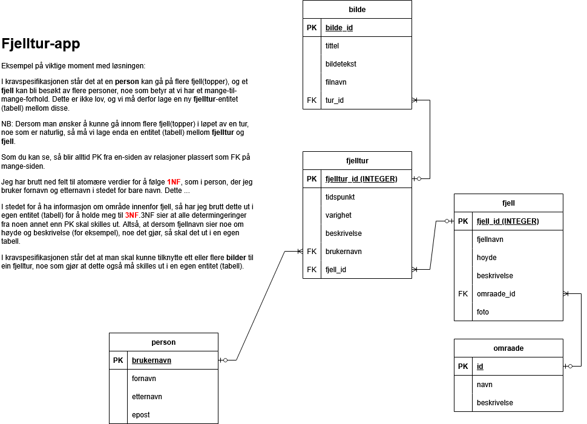

# Eksempel: Fjellturer (TypeScript – fullpakke)

Meny:
- [Om denne versjonen](#om-denne-versjonen)
- [Kom i gang](#kom-i-gang)
- [Mappestruktur](#mappestruktur)
- [Slik henger det sammen](#slik-henger-det-sammen)
  - [1. Typene skrives én gang: i skjemaet](#1-typene-skrives-én-gang-i-skjemaet)
  - [2. Editoren vet hva som finnes](#2-editoren-vet-hva-som-finnes)
  - [3. Bryter du reglene, blir koden ikke bygget](#3-bryter-du-reglene-blir-koden-ikke-bygget)
  - [4. Én type, fra databasen til nettleseren](#4-én-type-fra-databasen-til-nettleseren)
  - [5. Data utenfra sjekkes ved døren](#5-data-utenfra-sjekkes-ved-døren)
- [Endre databasen](#endre-databasen)
- [Prøv selv](#prøv-selv)
- [Feilsøking](#feilsøking)

## Om denne versjonen

Dette er det tredje fjelltur-eksempelet. Appen gjør det samme som i [fjelltur-eksempel](../fjelltur-eksempel/) (JavaScript) og [fjelltur-eksempel-typescript](../fjelltur-eksempel-typescript/): vise fjell, vise turene til en person og registrere nye turer. Forskjellen er *hvordan* TypeScript brukes sammen med databasen.

Her er målet å vise hvordan det gjøres i et typisk profesjonelt prosjekt:

| | fjelltur-eksempel-typescript | Denne versjonen (fullpakke) |
|---|---|---|
| Hvor kommer typene fra? | Interfacer skrevet for hånd | Laget automatisk fra databaseskjemaet |
| Spørringer mot databasen | SQL i tekststrenger (`better-sqlite3`) | Drizzle ORM – ligner SQL, men med typer |
| Typer i nettleseren | Egne kopier av interfacene | De samme typene som serveren bruker |
| Hente HTML-elementer | `as HTMLSelectElement` (et løfte) | `hentElement(...)` (en sjekk) |
| Data som kommer inn til serveren | Blir stolt på | Valideres med Zod, laget fra skjemaet |

Eksempelet forutsetter at du kan JavaScript, Node.js, Express og SQL, og at du har sett litt TypeScript før (f.eks. i [fjelltur-eksempel-typescript](../fjelltur-eksempel-typescript/)). Datamodellen er den samme som i de andre eksemplene:



Databasen bruker de samme tabell- og kolonnenavnene som før, så [SQL-oppgavene](./SQL%20-%20oppgaver%20og%20løsningsforslag.md) fungerer også her.

## Kom i gang

Du trenger en oppdatert LTS-versjon av [Node.js](https://nodejs.org/). Åpne en terminal i denne mappen og kjør:

```bash
npm install
npm start
```

Åpne [http://localhost:3000](http://localhost:3000) i nettleseren.

`npm start` gjør tre ting etter hverandre: sjekker alle typene, bygger nettleserkoden og starter serveren. Finnes det en typefeil, stopper det på første steg – serveren starter ikke før feilen er rettet.

Alle skriptene:

| Kommando | Hva den gjør |
|---|---|
| `npm start` | Sjekker typer, bygger nettleserkoden og starter serveren |
| `npm run typecheck` | Sjekker typene i all koden (server og nettleser) |
| `npm run build` | Bygger `src/nettleser/*.ts` til `public/js/*.js` |
| `npm run db:nullstill` | Lager `fjelltur.db` helt på nytt med testdata |
| `npm run db:generer` | Lager en ny SQL-migrasjon etter at du har endret skjemaet |
| `npm run db:studio` | Åpner Drizzle Studio, et nettleserverktøy for å se og endre data |

## Mappestruktur

```
fjelltur-eksempel-typescript-fullpakke/
├── src/
│   ├── db/
│   │   ├── skjema.ts        ← tabellene og typene (start her!)
│   │   ├── klient.ts        ← kobler til SQLite-databasen
│   │   ├── testdata.ts      ← testdata, med typer
│   │   └── nullstill.ts     ← lager databasen på nytt
│   ├── felles/
│   │   └── api.ts           ← "kontrakten" mellom server og nettleser
│   ├── server/
│   │   ├── app.ts           ← Express-serveren og API-rutene
│   │   └── validering.ts    ← sjekker data som kommer inn
│   └── nettleser/
│       ├── hjelpere.ts      ← hentElement, hentJson m.m.
│       ├── index.ts
│       ├── eks-fjellturer-for-person.ts
│       └── eks-registrere-ny-tur.ts
├── public/                  ← HTML, CSS og bilder (+ js/ som bygges)
├── drizzle/                 ← SQL-migrasjoner laget av drizzle-kit
├── fjelltur.db              ← SQLite-databasen
├── drizzle.config.ts
├── tsconfig.json            ← TypeScript-innstillinger for server og database
└── tsconfig.nettleser.json  ← TypeScript-innstillinger for nettleserkoden
```

Hvorfor to `tsconfig`-filer? Serverkoden kjører i Node.js og vet ingenting om `document`. Nettleserkoden kjører i nettleseren og vet ingenting om filsystemet. Hver fil forteller TypeScript hvilket miljø koden skal kjøre i.

Hvorfor `esbuild`? Nettleserkoden henter typer fra `src/db` og `src/felles`. `esbuild` setter sammen hver side til én JavaScript-fil i `public/js` og fjerner alle typene. Selve typesjekken gjøres av `tsc` (`npm run typecheck`), fordi `esbuild` og `tsx` *ikke* sjekker typer – de bare fjerner dem.

## Slik henger det sammen

```
                    src/db/skjema.ts
                  (tabeller + typer)
          ┌───────────────┼────────────────┬──────────────────┐
          ▼               ▼                ▼                  ▼
   drizzle/*.sql    src/server/      src/felles/api.ts    src/server/
   (lager tabellene  app.ts          (svar fra API-et)    validering.ts
    i fjelltur.db)   (spørringer)          │              (sjekker req.body)
                          ▲                ▼
                          └──── src/nettleser/*.ts
                                (samme typer i nettleseren)
```

### 1. Typene skrives én gang: i skjemaet

I [`src/db/skjema.ts`](src/db/skjema.ts) beskrives hver tabell i TypeScript. Det ligner mye på `CREATE TABLE`:

```typescript
export const fjelltur = sqliteTable('fjelltur', {
    id: integer('fjelltur_id').primaryKey({ autoIncrement: true }),
    tidspunkt: text('tidspunkt').notNull(),
    varighet: integer('varighet').notNull(), // minutter
    beskrivelse: text('beskrivelse'),
    brukernavn: text('brukernavn').notNull()
        .references(() => person.brukernavn),
    fjellId: integer('fjell_id').notNull()
        .references(() => fjell.id),
});

export type Fjelltur = typeof fjelltur.$inferSelect;   // en rad vi leser
export type NyFjelltur = typeof fjelltur.$inferInsert; // en rad vi setter inn
```

- `.notNull()` gir typen `string` (eller `number`). Uten `.notNull()` blir typen `string | null`, og TypeScript tvinger deg til å tenke på hva som skal skje når verdien mangler.
- Typene `Fjelltur` og `NyFjelltur` skrives aldri for hånd, og kan derfor aldri komme i utakt med databasen.
- `drizzle-kit` lager SQL-en for tabellene ut fra skjemaet. Se [`drizzle/0000_opprett_tabeller.sql`](drizzle/0000_opprett_tabeller.sql) – der finner du vanlige `CREATE TABLE`-setninger med `NOT NULL` og `FOREIGN KEY`.

### 2. Editoren vet hva som finnes

Spørringene i [`src/server/app.ts`](src/server/app.ts) skrives med Drizzle. De ligner på SQL, men resultatet har en type:

```typescript
const rader = db
    .select({
        fjellnavn: fjell.fjellnavn,
        tidspunkt: fjelltur.tidspunkt,
        varighet: fjelltur.varighet,
    })
    .from(fjelltur)
    .innerJoin(fjell, eq(fjelltur.fjellId, fjell.id))
    .where(eq(fjelltur.brukernavn, req.params.brukernavn))
    .all();
```

Skriv `fjelltur.` eller `rader[0].` i VS Code, så får du en liste over alle feltene og typene deres. Hold musepekeren over `rader` for å se hele typen.

### 3. Bryter du reglene, blir koden ikke bygget

Prøv å legge dette inn i en av filene i `src/server`, og kjør `npm run typecheck`:

```typescript
const a: NyFjelltur = { brukernavn: 'kari', fjellId: 3, tidspunkt: '2026-06-01', varighet: '90' };
const b: NyFjelltur = { brukernavn: 'kari', fjellId: 3 };
turer[0]?.varigeht;
```

```
error TS2322: Type 'string' is not assignable to type 'number'.
error TS2739: Type '{ brukernavn: string; fjellId: number; }' is missing the following properties from type '...': tidspunkt, varighet
error TS2551: Property 'varigeht' does not exist on type '...'. Did you mean 'varighet'?
```

Feil type, felt som mangler og skrivefeil blir oppdaget før koden kjører – og `npm start` nekter å starte serveren.

### 4. Én type, fra databasen til nettleseren

[`src/felles/api.ts`](src/felles/api.ts) beskriver hva hvert API-endepunkt svarer med. Serveren bruker typene i `Response<...>`, og nettleseren bruker de samme typene når den henter data:

```typescript
// Server (src/server/app.ts)
app.get('/api/fjellturer/:brukernavn', (req: Request<{ brukernavn: string }>, res: Response<TurForPerson[]>) => { ... });

// Nettleser (src/nettleser/eks-fjellturer-for-person.ts)
const turer = await hentJson<TurForPerson[]>(`/api/fjellturer/${brukernavn}`);
```

Når en tur registreres, bygger nettleseren objektet med typen `NyFjelltur` – rett fra skjemaet ([`src/nettleser/eks-registrere-ny-tur.ts`](src/nettleser/eks-registrere-ny-tur.ts)):

```typescript
import type { NyFjelltur } from '../db/skjema';

const ny: NyFjelltur = {
    brukernavn: brukerValg.value,
    fjellId: Number(fjellValg.value),
    tidspunkt: datoFelt.value,
    varighet: varighetFelt.valueAsNumber,
    beskrivelse: beskrivelseFelt.value || null,
};
```

`import type` henter bare typen. Importen forsvinner når koden bygges, så nettleseren laster aldri databasekoden. Legg også merke til `valueAsNumber`: Verdien gjøres om til et tall der den kommer inn, og er et tall hele veien til databasen.

Endrer noen skjemaet eller `api.ts`, får både serveren og nettleserkoden typefeil der koden ikke lenger passer.

I stedet for `document.getElementById('x') as HTMLSelectElement` bruker nettleserkoden `hentElement('x', HTMLSelectElement)` fra [`src/nettleser/hjelpere.ts`](src/nettleser/hjelpere.ts). `as` er bare et løfte til TypeScript, mens `hentElement` faktisk sjekker at elementet finnes og har riktig type – og gir en tydelig feilmelding hvis ikke.

### 5. Data utenfra sjekkes ved døren

TypeScript-typene finnes bare mens du skriver koden. Når serveren kjører, kan hvem som helst sende hva som helst i en POST-forespørsel. Derfor sjekkes `req.body` med Zod i [`src/server/validering.ts`](src/server/validering.ts), og valideringen lages fra det samme skjemaet:

```typescript
export const nyTurSkjema = createInsertSchema(fjelltur, {
    tidspunkt: (s) => s.regex(/^\d{4}-\d{2}-\d{2}$/, 'må være en dato på formen ÅÅÅÅ-MM-DD'),
    varighet: (s) => s.positive('må være et positivt antall minutter'),
    brukernavn: (s) => s.min(1, 'må fylles ut'),
}).omit({ id: true });
```

```typescript
const resultat = nyTurSkjema.safeParse(req.body);
if (!resultat.success) {
    res.status(400).json({ feil: 'Ugyldige data', detaljer: ... });
    return;
}
const nyTur = resultat.data; // herfra vet TypeScript at dataene er gyldige
```

Kort sagt: **Typene sjekker koden. Valideringen sjekker dataene.**

## Endre databasen

Når du vil endre en tabell (f.eks. legge til en kolonne):

1. Endre tabellen i `src/db/skjema.ts`.
2. Kjør `npm run typecheck`. Nå viser TypeScript deg alle stedene i koden som må oppdateres.
3. Kjør `npm run db:generer`. Det lager en ny SQL-fil i `drizzle/` med endringen.
4. Kjør `npm run db:nullstill` for å lage databasen på nytt.

NB: `db:nullstill` sletter `fjelltur.db` og alt du har registrert, og legger inn testdataene fra `src/db/testdata.ts` på nytt.

## Prøv selv

1. **Ødelegg med vilje.** Fjern `.notNull()` fra `varighet` i skjemaet og kjør `npm run typecheck`. Hvor klager TypeScript, og hvorfor? (Hint: Feilen dukker opp i nettleserkoden, selv om du bare endret databaseskjemaet.)
2. **Ny kolonne hele veien.** Legg til `vanskelighetsgrad` (f.eks. et tall fra 1 til 5) på `fjelltur`. Følg stegene i [Endre databasen](#endre-databasen), og la typefeilene vise deg hva som må endres i server, validering og nettleser.
3. **Nytt endepunkt.** Lag `GET /api/omraader` som returnerer alle områdene. Lag en type for svaret i `src/felles/api.ts`, og vis områdene på forsiden.
4. **Bilder.** Tabellen `bilde` finnes, men brukes ikke ennå. Lag et endepunkt som henter bildene til en tur, og vis dem på siden med fjellturer.
5. **Se SQL-en.** Bytt ut `.all()` med `.toSQL()` i en av spørringene og skriv resultatet til konsollen. Hvilken SQL lager Drizzle for deg?
6. **Utforsk dataene.** Kjør `npm run db:studio` og se på tabellene i nettleseren.

## Feilsøking

- **`npm start` stopper med «error TS…»**: Det er en typefeil. Les meldingen – den sier hvilken fil og linje det gjelder.
- **npm sier at «install scripts» ikke er tillatt, og `better-sqlite3` eller `esbuild` ikke virker**: Nyere versjoner av npm spør før de kjører installasjonsskript. Kjør `npm install-scripts approve better-sqlite3 esbuild` og deretter `npm rebuild`.
- **Feil om at porten er i bruk**: En annen server kjører allerede på port 3000. Stopp den (Ctrl+C i terminalen der den kjører) og prøv igjen.
- **Databasen ser rar ut etter at du har endret skjemaet**: Kjør `npm run db:generer` og så `npm run db:nullstill`.
