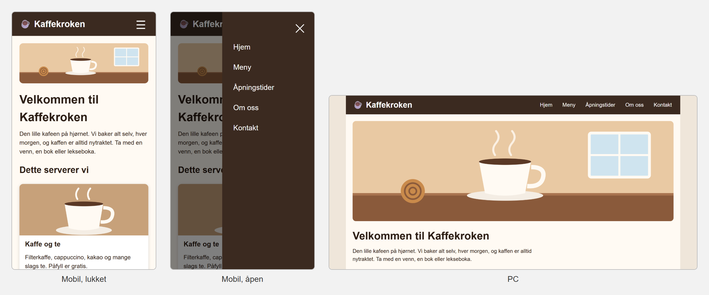
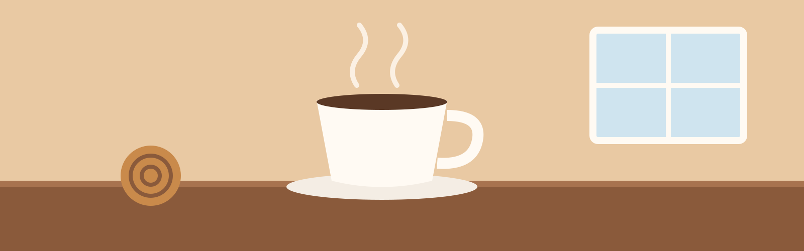
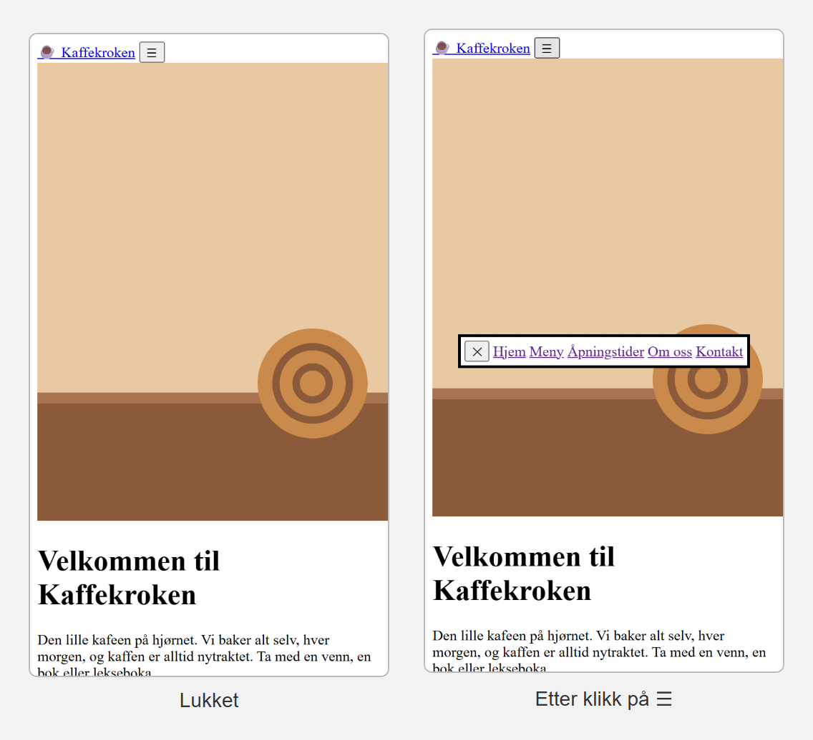
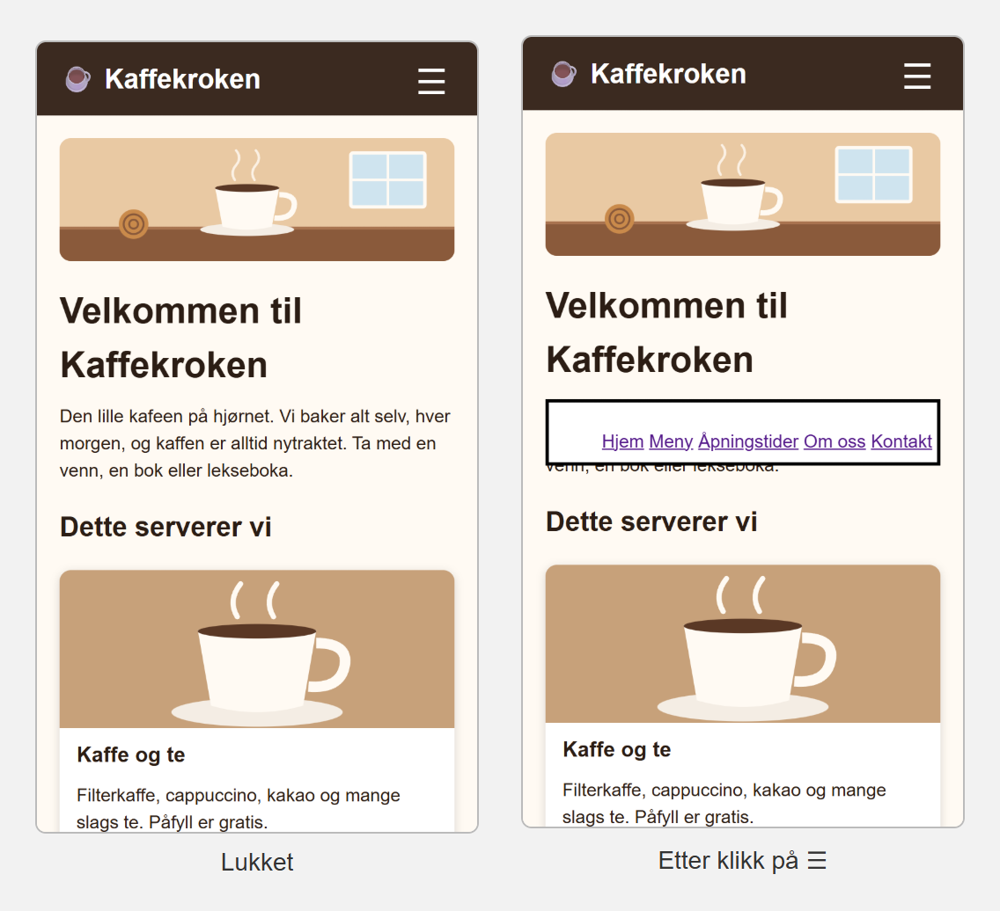
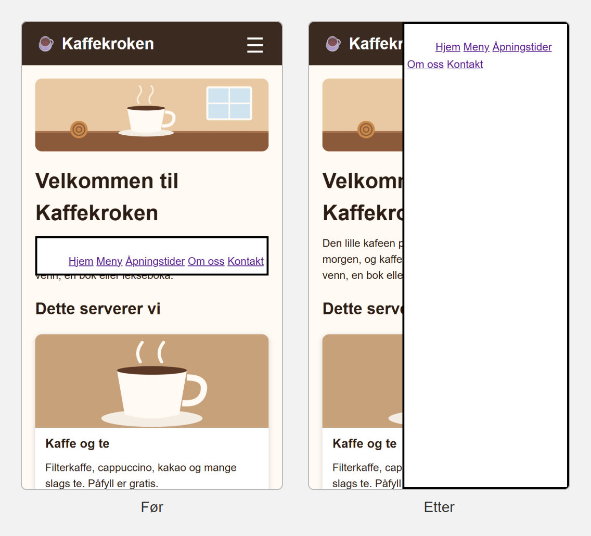
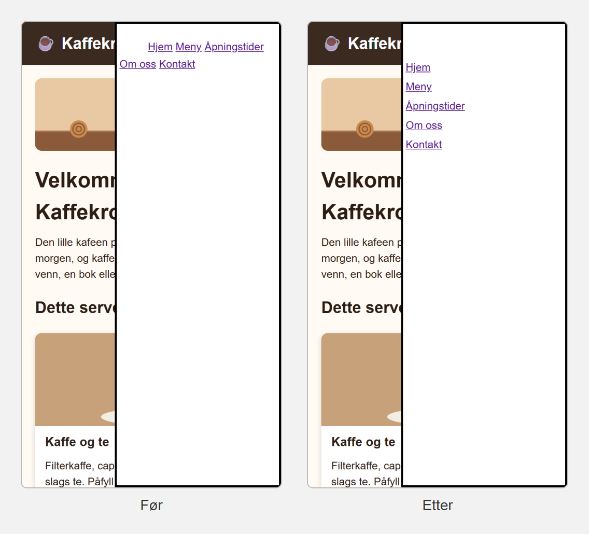
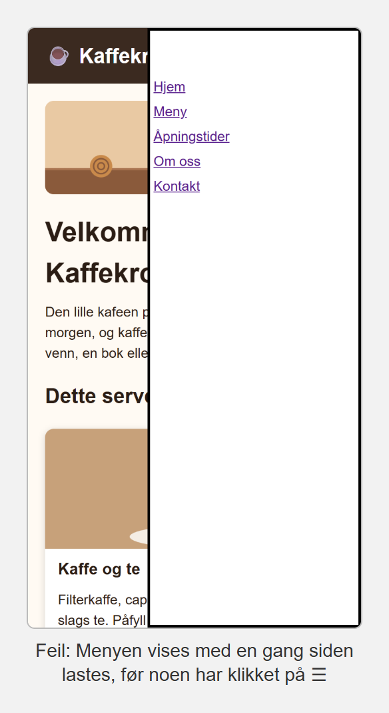
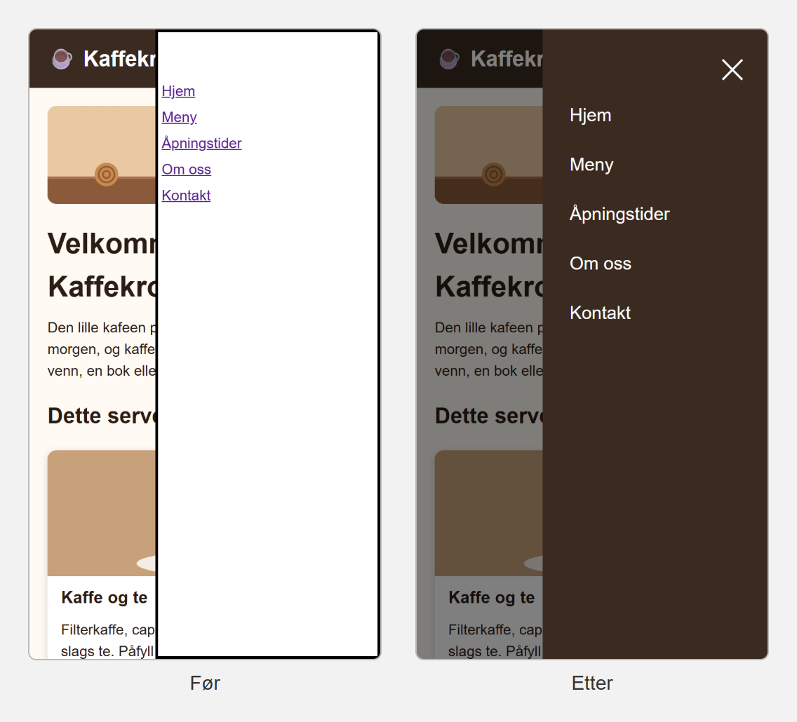
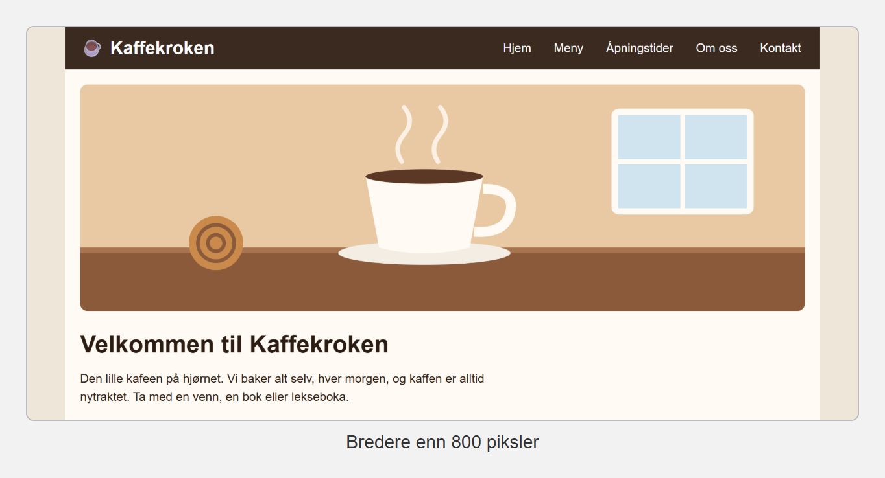

# Hamburgermeny uten JavaScript – steg for steg

En *hamburgermeny* er de tre strekene ☰ du ser øverst på mange nettsider på mobil. Klikker du på dem, kommer menyen fram. I denne oppgaven lager vi en slik meny for en liten kafé. Menyen glir inn fra høyre side av skjermen.



Det finnes mange eksempler på hamburgermenyer på nettet, blant annet [hos W3Schools](https://www.w3schools.com/howto/howto_js_sidenav.asp). De fleste bruker JavaScript til å vise og skjule menyen. **Det trenger vi ikke lenger.** HTML har fått et eget attributt for akkurat dette: `popover`. Det er ikke et triks eller et «hack», men den vanlige måten å gjøre det på i moderne HTML.

Du trenger det du har lært fra før: flexbox fra [CSS-guiden](../guide%20-%20css.md#7-flexbox), og gjerne media queries fra [den responsive nettsiden](../responsiv-nettside/README.md).

> **Tips:** Lagre og oppdater nettleseren etter *hvert* steg, og klikk på ☰ for å se hva som har endret seg.

---

## Steg 0: Hva er en popover?

En **popover** er noe som «popper opp» over resten av siden når du klikker på en knapp: en meny, en liten hjelpetekst eller en melding. Det trengs bare to attributter:

```html
<button popovertarget="meny">☰</button>   <!-- knappen som åpner -->

<nav id="meny" popover>...</nav>            <!-- det som åpnes -->
```

- `popover` på et element betyr: «Jeg er skjult til noen åpner meg.»
- `popovertarget="meny"` på en knapp betyr: «Når du klikker på meg, åpner eller lukker jeg elementet med `id="meny"`.»

Og så får du mye gratis, som du ellers måtte ha programmert selv:

| | W3Schools-eksempelet (JavaScript) | `popover` (bare HTML) |
|---|---|---|
| Åpne og lukke med knapp | Ja, med to funksjoner i JS | Ja |
| Lukke med **Esc**-tasten | Nei | Ja |
| Lukke ved å klikke **utenfor** menyen | Nei | Ja |
| Ligger alltid **øverst**, over alt annet | Må fikses med `z-index` | Ja |
| Skjermlesere får vite om menyen er åpen eller lukket | Nei | Ja |
| Tastaturet hopper tilbake til knappen når menyen lukkes | Nei | Ja |
| Linjer med JavaScript | ca. 8 | 0 |

`popover` virker i alle de store nettleserne (Chrome, Edge, Firefox og Safari) siden 2024.

---

# Del 1 – HTML

## Steg 1: HTML

Lag en mappe med `index.html`, en tom `style.css` og en mappe `bilder/` med bildene fra [bilder](bilder/).

**index.html**

```html
<!DOCTYPE html>
<html lang="no">
<head>
    <meta charset="UTF-8">
    <meta name="viewport" content="width=device-width, initial-scale=1.0">
    <title>Kaffekroken</title>
    <link rel="stylesheet" href="style.css">
</head>
<body>
    <header>
        <a href="index.html" class="logo">☕ Kaffekroken</a>

        <button class="meny-knapp" popovertarget="meny" aria-label="Åpne meny">☰</button>

        <nav id="meny" popover>
            <button class="lukk-knapp" popovertarget="meny" popovertargetaction="hide" aria-label="Lukk meny">✕</button>
            <a href="#">Hjem</a>
            <a href="#">Meny</a>
            <a href="#">Åpningstider</a>
            <a href="#">Om oss</a>
            <a href="#">Kontakt</a>
        </nav>
    </header>

    <main>
        <section class="hero">
            
            <h1>Velkommen til Kaffekroken</h1>
            <p>Den lille kafeen på hjørnet. Vi baker alt selv, hver morgen, og kaffen er alltid nytraktet. Ta med en venn, en bok eller lekseboka.</p>
        </section>

        <h2>Dette serverer vi</h2>
        <div class="kort-liste">
            <article class="kort">
                
                <h3>Kaffe og te</h3>
                <p>Filterkaffe, cappuccino, kakao og mange slags te. Påfyll er gratis.</p>
            </article>
            <!-- ... to kort til, på samme måte: bolle.svg og lunsj.svg -->
        </div>
    </main>

    <footer>
        <p>© 2026 Kaffekroken · Hjørnegata 1</p>
    </footer>
</body>
</html>
```

Hele HTML-filen med alle tre kortene finner du i [index.html](index.html).

Se på de tre linjene i `header` som har med menyen å gjøre:

| Kode | Hva den gjør |
|---|---|
| `<button ... popovertarget="meny">☰</button>` | Hamburger-knappen. Åpner og lukker elementet med `id="meny"`. |
| `<nav id="meny" popover>` | Selve menyen. Er skjult til den blir åpnet. |
| `<button ... popovertarget="meny" popovertargetaction="hide">✕</button>` | Et kryss inni menyen. `popovertargetaction="hide"` betyr at denne knappen **bare lukker**. |

Noen ting er verdt å legge merke til:

- **Det er `<button>`, ikke `<a>` eller `<div>`.** En lenke tar deg til en annen side. En knapp *gjør noe* på siden du er på. `popovertarget` virker bare på knapper.
- **`aria-label`** er teksten skjermlesere leser opp. En blind bruker får ikke mye ut av «☰», men «Åpne meny» forstår alle.
- **Menyen er en vanlig `<nav>`.** Den er like semantisk som en hvilken som helst annen meny. Den har bare fått et ekstra attributt.

**Slik ser det ut nå** (uten CSS):



**Menyen virker allerede!** Den er skjult når siden lastes, og den dukker opp når du klikker på ☰. Prøv også:

- Trykk **Esc**. Menyen lukkes.
- Åpne menyen og klikk et sted **utenfor** den. Menyen lukkes.
- Klikk på ✕. Menyen lukkes.

Alt dette uten én eneste linje CSS eller JavaScript. Resten av oppgaven handler bare om **utseendet**.

> **Bildet er alt for stort?** Ja, det er 1600 piksler bredt. Det fikser vi i neste steg, akkurat som i [den responsive nettsiden](../responsiv-nettside/README.md#steg-2-grunnoppsett-og-bilder-som-krymper).

---

# Del 2 – CSS

## Steg 2: Grunnoppsett, logo og hamburger-knapp

Først grunnoppsettet. Dette kjenner du igjen fra den responsive nettsiden, så vi går ikke gjennom det i detalj:

**style.css**

```css
* {
    box-sizing: border-box;
}

html {
    background-color: #efe6da;
}

body {
    margin: 0 auto;
    max-width: 1000px;
    background-color: #fffaf3;
    font-family: Arial, Helvetica, sans-serif;
    line-height: 1.5;
    color: #2b1d14;
}

img {
    max-width: 100%;
    height: auto;
    display: block;
}

main,
footer {
    padding: 20px;
}

.hero img {
    border-radius: 10px;
}

.hero h1 {
    margin: 20px 0 10px;
}

.hero p {
    max-width: 600px;
    margin: 0;
}

.kort-liste {
    display: grid;
    grid-template-columns: repeat(auto-fit, minmax(220px, 1fr));
    gap: 20px;
}

.kort {
    background-color: white;
    border-radius: 10px;
    overflow: hidden;
    box-shadow: 0 2px 8px rgba(0, 0, 0, 0.15);
}

.kort img {
    width: 100%;
    height: 140px;
    object-fit: cover;
}

.kort h3,
.kort p {
    margin: 10px 15px;
}

footer {
    background-color: #3b2a20;
    color: white;
    text-align: center;
}
```

Så toppen av siden. Logo til venstre og knapp til høyre, med flexbox, slik du har gjort før:

```css
header {
    display: flex;
    justify-content: space-between;   /* logo til venstre, knapp til høyre */
    align-items: center;
    padding: 10px 20px;
    background-color: #3b2a20;
}

.logo {
    color: white;
    text-decoration: none;
    font-size: 1.5rem;
    font-weight: bold;
}

.meny-knapp,
.lukk-knapp {
    background: none;
    border: none;
    color: white;
    font-size: 2rem;
    cursor: pointer;                  /* «hånd» når musen er over */
}
```

Knapper har en grå bakgrunn og en ramme fra nettleseren. Den fjerner vi med `background: none` og `border: none`, slik at bare ☰ blir igjen.

Legg merke til at `nav` ikke er med i flexboksen. Den er jo skjult, og tar ingen plass. Derfor havner knappen helt til høyre.

**Slik ser det ut nå:**



Siden ser fin ut, men menyen (høyre bilde) dukker opp **midt på skjermen**, som en liten boks med svart ramme. Det er slik nettleseren viser en popover hvis vi ikke sier noe annet. Krysset er der også, men det er hvitt på hvitt, så du ser det ikke ennå.

---

## Steg 3: Flytt menyen til høyre side

Hvorfor havner menyen midt på skjermen? Det er to grunner:

1. **En popover ligger ikke inni siden som andre elementer.** Nettleseren legger den i et eget lag *over* alt annet, og måler den mot **nettleservinduet**. Derfor trenger vi aldri `z-index` for å få menyen øverst.
2. **Nettleseren gir den `margin: auto`.** Husker du at `margin: 0 auto` sentrerer en boks? Her er det `auto` på alle sider, så popoveren havner midt i vinduet.

Da er det enkelt å få menyen over til høyre. Vi fjerner margen, og setter bare `auto` på venstre side. Da skyves menyen helt til høyre:

```css
#meny {
    margin: 0;
    margin-left: auto;                /* skyv menyen helt til høyre */
    height: 100%;                     /* like høy som nettleservinduet */
    width: 250px;
    max-width: 80%;
}
```

- `height: 100%` gjør menyen like høy som vinduet, fordi popoveren måles mot vinduet.
- `max-width: 80%` gjør at menyen aldri dekker mer enn 80 % av en smal mobil. Da ser du fortsatt litt av siden bak, og skjønner at du kan klikke der for å lukke.

**Slik ser det ut nå:**



Menyen er på plass! Men lenkene ligger på rekke og rad, slik lenker alltid gjør. Neste steg legger dem under hverandre.

---

## Steg 4: Lenkene under hverandre

Lenkene skal ligge under hverandre, og det gjør vi med flexbox: `display: flex` og `flex-direction: column`. Men **pass på hvor du skriver det**:

```css
#meny:popover-open {
    display: flex;
    flex-direction: column;
    gap: 5px;
}
```

`:popover-open` er en pseudoklasse, akkurat som `:hover`. Den betyr «**bare når popoveren er åpen**».

**Slik ser det ut nå:**



> **Vanlig feil: `display: flex` rett på `#meny`**
>
> Det er fristende å skrive `display: flex` sammen med de andre reglene i `#meny`. Men nettleseren skjuler popoveren med `display: none`. Skriver du `display: flex` på `#meny`, overstyrer du det, og menyen vises **hele tiden**:
>
> 
>
> Huskeregel: **`display` på en popover skal alltid stå i `:popover-open`.**

---

## Steg 5: Farger, lukkeknapp og mørk bakgrunn

Nå gjør vi menyen pen. Legg til farger og luft på `#meny`, og style lenkene:

```css
#meny {
    padding: 20px;
    border: none;
    background-color: #3b2a20;
}

#meny a {
    color: white;
    text-decoration: none;
    font-size: 1.25rem;
    padding: 10px;
    border-radius: 5px;
}

#meny a:hover {
    background-color: #5a4334;
}

.lukk-knapp {
    align-self: flex-end;             /* krysset helt til høyre */
}
```

Det er lov å skrive `#meny { ... }` flere ganger i samme CSS-fil. Reglene legges sammen. Vi gjør det her for å holde stegene adskilt.

`align-self: flex-end` flytter krysset. I en flexboks med `flex-direction: column` går den andre aksen *bortover*, så `flex-end` betyr «helt til høyre».

Til slutt gjør vi resten av siden litt mørkere når menyen er åpen. Det får vi også nesten gratis: En popover har et eget element bak seg, `::backdrop`, som dekker hele vinduet:

```css
#meny::backdrop {
    background-color: rgba(0, 0, 0, 0.5);   /* gjør resten av siden mørkere */
}
```

`rgba(0, 0, 0, 0.5)` er svart (`0, 0, 0`) som er 50 % gjennomsiktig (`0.5`).

**Slik ser det ut nå:**



Menyen er ferdig! Den mørke bakgrunnen viser at resten av siden er «satt på pause», og at du kan klikke der for å lukke menyen.

---

## Steg 6: Test menyen på ordentlig

Vi har fått mye gratis med `popover`. Test at det virker:

1. **Mus:** Åpne med ☰. Lukk med ✕, og ved å klikke på den mørke delen av siden.
2. **Tastatur:** Trykk **Tab** til ☰ er markert, og trykk **Enter**. Trykk **Tab** for å gå gjennom lenkene. Trykk **Esc**. Legg merke til at markeringen hopper tilbake til ☰, så du kan fortsette der du var.
3. **Mobil:** Bruk mobilvisningen i utviklerverktøyene (**F12**, og så mobil-ikonet), eller publiser siden og åpne den på mobilen din.

> **Se det selv i utviklerverktøyene:** Åpne menyen, trykk **F12** og se på `<nav>` i Elements-fanen. Det står `top-layer` ved siden av den. Det er det egne laget over resten av siden. Klikk på `button` og se i **Accessibility**-fanen: Der står `expanded: true` når menyen er åpen, og `false` når den er lukket. Det er det skjermlesere bruker, og nettleseren ordner det helt av seg selv.

---

# Del 3 – Bonus

## Steg 7: La menyen gli inn fra høyre

Akkurat nå dukker menyen bare opp. Det er helt greit, men det er litt finere om den **glir inn** fra kanten. Legg dette nederst i CSS-filen:

```css
#meny {
    transition: translate 0.3s, display 0.3s allow-discrete, overlay 0.3s allow-discrete;
    translate: 100% 0;                /* skjult: flyttet ut til høyre */
}

#meny:popover-open {
    translate: 0 0;                   /* åpen: på plass */
}

@starting-style {
    #meny:popover-open {
        translate: 100% 0;            /* start utenfor skjermen når den åpnes */
    }
}
```

Dette er litt mer avansert, så vi tar det bit for bit:

- `translate: 100% 0` flytter menyen 100 % av sin egen bredde mot høyre, altså helt ut av skjermen. `translate: 0 0` flytter den tilbake på plass.
- `transition: translate 0.3s` gjør at flyttingen tar 0,3 sekunder, i stedet for å skje med en gang.
- `@starting-style` forteller nettleseren hvor menyen skal **starte** når den åpnes. Uten den vet ikke nettleseren hvor den skal gli fra, fordi menyen ikke fantes på skjermen et øyeblikk før.
- `display ... allow-discrete` og `overlay ... allow-discrete` gjør at menyen ikke forsvinner med en gang den lukkes, men får gli ut først.

Animasjonen virker i nyere nettlesere. I en eldre nettleser åpnes menyen bare uten animasjon, men den virker helt som før.

---

## Steg 8: Vanlig meny på store skjermer

På en PC er det god plass, og der er det ikke noe poeng å gjemme menyen bak ☰. Med en media query kan vi vise menyen som en vanlig meny når skjermen er bred nok:

```css
@media (min-width: 800px) {
    .meny-knapp,
    .lukk-knapp {
        display: none;
    }

    #meny {
        display: flex;
        gap: 20px;
        position: static;             /* tilbake på sin vanlige plass i header */
        width: auto;
        height: auto;
        padding: 0;
        background: none;
        translate: none;
        transition: none;
    }

    #meny a {
        font-size: 1rem;
        padding: 5px;
    }
}
```

- Knappene skjuler vi med `display: none`.
- `display: flex` på `#meny` er akkurat «feilen» fra steg 4. Men nå er det det vi **vil**: På store skjermer skal menyen vises hele tiden.
- `position: static` betyr «ligg på din vanlige plass i HTML-en». Da havner menyen inni `header`, ved siden av logoen, i stedet for å være festet til vinduet.
- Resten nullstiller det vi gjorde i steg 3, 5 og 7.

**Slik ser det ut nå** (skjerm som er bredere enn 800 piksler):



Samme HTML, men på mobil er det en hamburgermeny, og på PC en vanlig meny.

---

## Vanlige spørsmål

### Menyen lukker seg ikke når jeg klikker på en lenke

Det stemmer. Et klikk *inni* menyen lukker den ikke. På en vanlig nettside med flere sider merker du ikke det, fordi lenken laster en ny side, og da starter menyen lukket.

Men lenker du til et sted **på samme side** (som `href="#apningstider"`), blir menyen stående åpen. Da er dette et sted der én linje JavaScript faktisk er det enkleste. Legg til `onclick` på lenkene:

```html
<a href="#apningstider" onclick="meny.hidePopover()">Åpningstider</a>
```

`meny` er `id`-en til menyen, og `hidePopover()` lukker den.

### Hva med «checkbox-trikset»?

Du finner mange eksempler der en skjult `<input type="checkbox">` brukes til å vise og skjule menyen med `:checked`. Det var en smart løsning før `popover` fantes, men det *er* et hack: En avkrysningsboks er laget for skjema, ikke for menyer. Skjermlesere leser den opp som «avkrysningsboks», og du får ikke Esc, klikk utenfor eller noe av det andre fra tabellen i steg 0.

### Kan jeg ikke bare bruke `<details>` og `<summary>`?

Jo, `<details>` viser og skjuler også innhold uten JavaScript, og passer fint til ting som en FAQ eller en meny som skal *skyve resten av siden nedover*. Men den legger seg ikke over siden, og lukkes ikke med Esc eller ved å klikke utenfor. Til en meny som skal poppe opp over siden, er `popover` laget for jobben.

### Jeg har sett `command` og `commandfor` på knapper. Hva er det?

Det er en enda nyere måte å skrive det samme på:

```html
<button commandfor="meny" command="toggle-popover">☰</button>
```

Den gjør akkurat det samme som `popovertarget="meny"`, men kan også brukes til andre ting, som å åpne en `<dialog>`. Den har bare vært støttet i alle nettlesere siden slutten av 2025, så vi bruker `popovertarget` her.

---

## Oppsummering

| Hva | Kode |
|---|---|
| Elementet som skal poppe opp | `<nav id="meny" popover>` |
| Knappen som åpner og lukker | `<button popovertarget="meny">☰</button>` |
| Knappen som bare lukker | `<button popovertarget="meny" popovertargetaction="hide">✕</button>` |
| Tekst til skjermlesere | `aria-label="Åpne meny"` |
| Menyen til høyre | `margin: 0; margin-left: auto; height: 100%;` |
| Styling når menyen er åpen | `#meny:popover-open { display: flex; ... }` |
| Mørk bakgrunn bak menyen | `#meny::backdrop { background-color: rgba(0, 0, 0, 0.5); }` |
| Gli inn fra siden *(bonus)* | `transition`, `translate` og `@starting-style` |
| Vanlig meny på PC *(bonus)* | `@media (min-width: 800px) { ... }` med `position: static` |

**Bruk HTML til å vise og skjule, og CSS til utseendet. JavaScript trengs ikke.**

---

## Oppgaver

1. **Fra venstre.** Få menyen til å komme fra venstre side i stedet. Hint: Hvilken side skal ha `auto` i margen? Husk animasjonen i steg 7 også.
2. **Ned fra toppen.** Lag en meny som dekker hele bredden og kommer ned fra toppen, i stedet for fra siden.
3. **Hamburger-knapp med tekst.** Mange brukere skjønner ikke hva ☰ betyr. Endre knappen til `☰ Meny`. Trenger du `aria-label` nå?
4. **Mindre bevegelse.** Noen blir svimle av animasjoner, og har slått på «redusert bevegelse» på mobilen eller PC-en. Legg animasjonen fra steg 7 inni `@media (prefers-reduced-motion: no-preference) { ... }`. Da får bare de som ikke har slått det på, animasjonen.
5. **En popover til.** `popover` kan brukes til mer enn menyer. Lag en knapp «Åpningstider» på siden, som viser en liten boks med åpningstidene når du klikker på den.
6. **Din egen side.** Legg til en hamburgermeny på en nettside du har laget tidligere.

Løsningsforslag til oppgave 1 og 2 finner du [her](losningsforslag/README.md).

---

## Ferdig kode

Hele koden ligger i [index.html](index.html) og [style.css](style.css).

**style.css**

```css
/* ---------- Grunnoppsett (steg 2) ---------- */

* {
    box-sizing: border-box;
}

html {
    background-color: #efe6da;
}

body {
    margin: 0 auto;
    max-width: 1000px;
    background-color: #fffaf3;
    font-family: Arial, Helvetica, sans-serif;
    line-height: 1.5;
    color: #2b1d14;
}

img {
    max-width: 100%;
    height: auto;
    display: block;
}

main,
footer {
    padding: 20px;
}

.hero img {
    border-radius: 10px;
}

.hero h1 {
    margin: 20px 0 10px;
}

.hero p {
    max-width: 600px;
    margin: 0;
}

.kort-liste {
    display: grid;
    grid-template-columns: repeat(auto-fit, minmax(220px, 1fr));
    gap: 20px;
}

.kort {
    background-color: white;
    border-radius: 10px;
    overflow: hidden;
    box-shadow: 0 2px 8px rgba(0, 0, 0, 0.15);
}

.kort img {
    width: 100%;
    height: 140px;
    object-fit: cover;
}

.kort h3,
.kort p {
    margin: 10px 15px;
}

footer {
    background-color: #3b2a20;
    color: white;
    text-align: center;
}

/* ---------- Toppen: logo og hamburger-knapp (steg 2) ---------- */

header {
    display: flex;
    justify-content: space-between;   /* logo til venstre, knapp til høyre */
    align-items: center;
    padding: 10px 20px;
    background-color: #3b2a20;
}

.logo {
    color: white;
    text-decoration: none;
    font-size: 1.5rem;
    font-weight: bold;
}

.meny-knapp,
.lukk-knapp {
    background: none;
    border: none;
    color: white;
    font-size: 2rem;
    cursor: pointer;                  /* «hånd» når musen er over */
}

/* ---------- Menyen på høyre side (steg 3) ---------- */

#meny {
    margin: 0;
    margin-left: auto;                /* skyv menyen helt til høyre */
    height: 100%;                     /* like høy som nettleservinduet */
    width: 250px;
    max-width: 80%;
}

/* ---------- Lenkene under hverandre (steg 4) ---------- */

#meny:popover-open {
    display: flex;
    flex-direction: column;
    gap: 5px;
}

/* ---------- Farger, lukkeknapp og mørk bakgrunn (steg 5) ---------- */

#meny {
    padding: 20px;
    border: none;
    background-color: #3b2a20;
}

#meny a {
    color: white;
    text-decoration: none;
    font-size: 1.25rem;
    padding: 10px;
    border-radius: 5px;
}

#meny a:hover {
    background-color: #5a4334;
}

.lukk-knapp {
    align-self: flex-end;             /* krysset helt til høyre */
}

#meny::backdrop {
    background-color: rgba(0, 0, 0, 0.5);   /* gjør resten av siden mørkere */
}

/* ---------- Bonus: menyen glir inn fra høyre (steg 7) ---------- */

#meny {
    transition: translate 0.3s, display 0.3s allow-discrete, overlay 0.3s allow-discrete;
    translate: 100% 0;                /* skjult: flyttet ut til høyre */
}

#meny:popover-open {
    translate: 0 0;                   /* åpen: på plass */
}

@starting-style {
    #meny:popover-open {
        translate: 100% 0;            /* start utenfor skjermen når den åpnes */
    }
}

/* ---------- Bonus: vanlig meny på store skjermer (steg 8) ---------- */

@media (min-width: 800px) {
    .meny-knapp,
    .lukk-knapp {
        display: none;
    }

    #meny {
        display: flex;
        gap: 20px;
        position: static;             /* tilbake på sin vanlige plass i header */
        width: auto;
        height: auto;
        padding: 0;
        background: none;
        translate: none;
        transition: none;
    }

    #meny a {
        font-size: 1rem;
        padding: 5px;
    }
}
```
