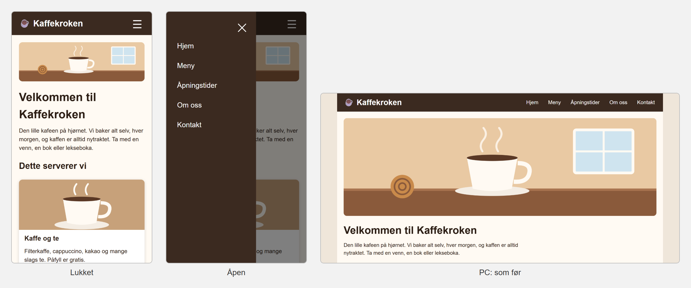
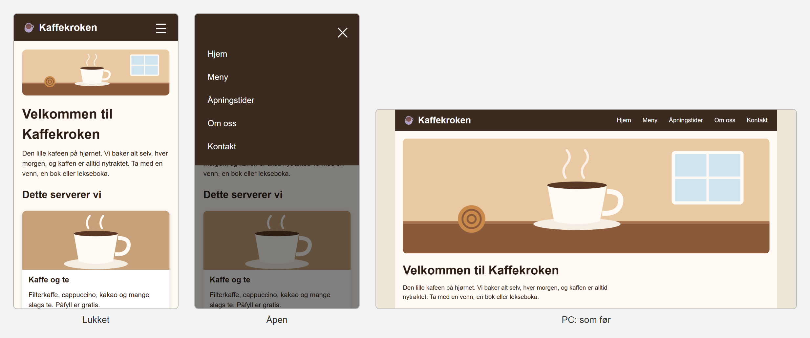

# Løsningsforslag – hamburgermeny

Her er løsningsforslag til oppgave 1 og 2 i [guiden](../README.md#oppgaver). Prøv selv først!

Vi viser bare det som er **endret** fra den ferdige koden i guiden. Vil du se alt, ligger hele løsningen i egne filer, og du kan åpne HTML-filen med Live Server:

| Oppgave | Åpne | CSS |
|---|---|---|
| 1. Fra venstre | [oppgave-1.html](oppgave-1.html) | [oppgave-1.css](oppgave-1.css) |
| 2. Ned fra toppen | [oppgave-2.html](oppgave-2.html) | [oppgave-2.css](oppgave-2.css) |

I CSS-filene er alt som er endret, merket med `ENDRET`, `NY` eller `FJERNET`.

---

## Oppgave 1: Menyen fra venstre



**Steg 3:** I stedet for `auto` på venstre side, setter vi `auto` på høyre side. Da skyves menyen helt til venstre:

```css
#meny {
    margin: 0;
    margin-right: auto;               /* ENDRET: skyv menyen helt til venstre */
    height: 100%;
    width: 250px;
    max-width: 80%;
}
```

**Steg 7:** Menyen må gli inn fra venstre, altså starte på `-100%` i stedet for `100%`. Det må endres begge steder:

```css
#meny {
    transition: translate 0.3s, display 0.3s allow-discrete, overlay 0.3s allow-discrete;
    translate: -100% 0;               /* ENDRET: skjult, flyttet ut til venstre */
}

@starting-style {
    #meny:popover-open {
        translate: -100% 0;           /* ENDRET: start utenfor skjermen til venstre */
    }
}
```

**Steg 8:** Her er det en felle! Sjekker du siden på en PC, ser du at menyen har flyttet seg bort til logoen. Det er fordi `margin-right: auto` fortsatt gjelder: Den skyver menyen så langt til *venstre* som mulig, også inni `header`. Vi fjerner margen i media queryen:

```css
@media (min-width: 800px) {
    #meny {
        /* ... som før ... */
        margin: 0;                    /* NY: ellers havner menyen inntil logoen */
    }
}
```

Uten margen gjør `justify-content: space-between` i `header` jobben igjen, og menyen havner til høyre.

> **Hva med krysset?** Det står fortsatt til høyre *i* menyen. Det er et greit sted, nær midten av skjermen. Vil du ha det til venstre, bytter du `align-self: flex-end` med `align-self: flex-start` i `.lukk-knapp`.

---

## Oppgave 2: Menyen ned fra toppen



**Steg 3:** Menyen skal dekke hele bredden, men bare være så høy som den trenger. Da blir det enklere enn før:

```css
#meny {
    margin: 0;                        /* ENDRET: fest menyen oppe til venstre */
    width: 100%;                      /* ENDRET: hele bredden */
    /* FJERNET: height og max-width. Da blir menyen bare så høy som innholdet */
}
```

- `margin: 0` fjerner `auto`-margen fra nettleseren, så menyen ikke lenger blir sentrert. Den havner da oppe til venstre.
- `width: 100%` gjør den like bred som vinduet.
- `height: 100%` er **fjernet**. Da bestemmer innholdet høyden, akkurat som med vanlige elementer.
- `max-width: 80%` er også fjernet. Den ville gjort at menyen aldri kunne bli bredere enn 80 %.

**Steg 7:** Nå skal menyen gli **loddrett**, ikke vannrett. `translate` tar to verdier: først bortover, så nedover. `0 -100%` betyr «ikke flytt bortover, men flytt opp en hel høyde»:

```css
#meny {
    transition: translate 0.3s, display 0.3s allow-discrete, overlay 0.3s allow-discrete;
    translate: 0 -100%;               /* ENDRET: skjult, flyttet opp over skjermen */
}

@starting-style {
    #meny:popover-open {
        translate: 0 -100%;           /* ENDRET: start over skjermen når den åpnes */
    }
}
```

**Steg 8:** Her trengs ingen endring. Vi har ingen `auto`-marg lenger, så `justify-content: space-between` i `header` legger menyen til høyre på PC.
