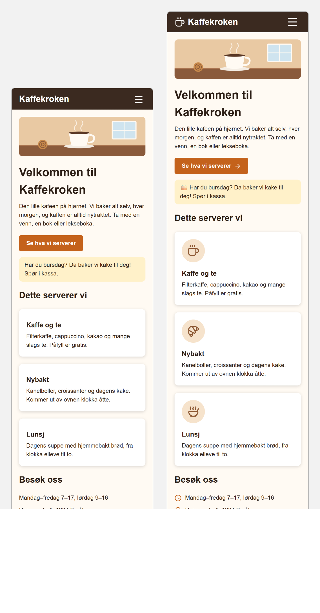
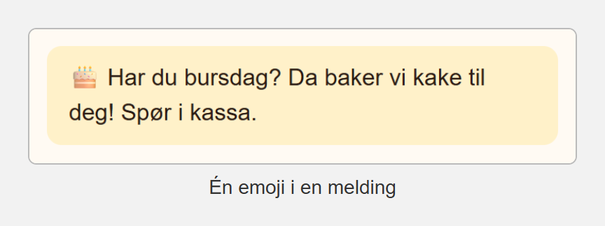
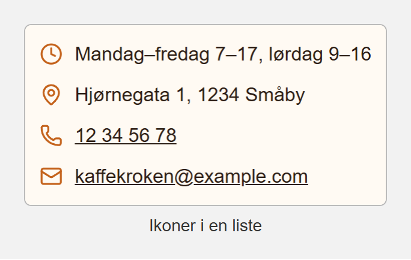
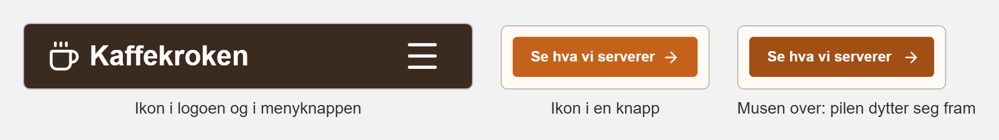
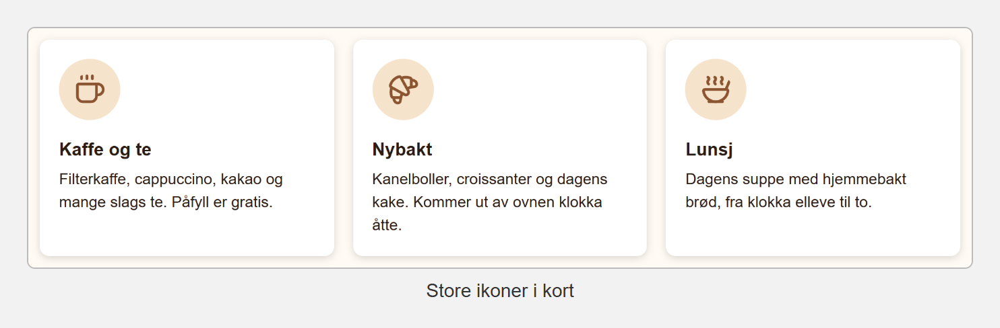

# Ikoner og emojis – gi siden mer liv

Små ikoner gjør en nettside lettere å lese og hyggeligere å se på. Et lite telefonrør foran telefonnummeret gjør at du finner det med en gang, uten å lese. Her ser du Kaffekroken fra [hamburgermeny-guiden](../hamburgermeny/README.md), med og uten ikoner. Det er samme tekst i begge bildene:



I denne guiden lærer du:

1. tre måter å legge ikoner inn på en side
2. hvordan du bruker emojis riktig
3. hvordan du henter og styler SVG-ikoner fra [Lucide](https://lucide.dev)
4. tre vanlige steder å bruke ikoner
5. noen tommelfingerregler, så ikonene gir liv og ikke rot

Hele eksempelet ligger i [index.html](index.html) og [style.css](style.css).

---

## 1. Tre måter å legge inn ikoner

| | Emoji | SVG-ikon i HTML-en | Bilde med `` |
|---|---|---|---|
| **Slik ser koden ut** | `🎂` | `<svg ...>...</svg>` | `` |
| **Oppsett** | Ingenting | Kopier og lim inn | Last ned fil |
| **Endre farge med CSS** | Nei | **Ja** | Nei |
| **Ser likt ut overalt** | Nei, ulikt på Windows, Mac og mobil | Ja | Ja |
| **Passer til** | En og annen glad detalj i tekst | Ikoner i menyer, knapper, lister og kort | Bilder og illustrasjoner |

Kort sagt:

- **Emojis** er raske, men du bestemmer ikke selv hvordan de ser ut.
- **SVG-ikoner** er det de fleste proffe nettsider bruker. De ser like ut overalt, og de får samme farge som teksten. Det er dem vi bruker mest i denne guiden.
- **``** er for bilder. Du kan bruke det til ikoner også, men da kan du ikke endre fargen med CSS.

> **Hva er SVG?** SVG er et bildeformat som består av *tekst*: «tegn en sirkel her, en strek der». Derfor kan du lime det rett inn i HTML-en, og det blir aldri uskarpt, uansett hvor stort du gjør det. Bildene på denne siden (`bilder/hero.svg`) er også SVG.

---

## 2. Emojis

### Slik skriver du en emoji

- **Windows:** Trykk **Windows-tasten + punktum** (`.`). Det kommer opp et vindu med emojis.
- **Mac:** Trykk **Ctrl + Cmd + mellomrom**, eller **🌐 + E**.

Emojien limes rett inn i koden, akkurat som en bokstav.

### Skjermlesere leser emojis høyt

Dette er lett å glemme: En skjermleser leser opp **navnet** på emojien. «🎂 Har du bursdag?» blir til «bursdagskake Har du bursdag?». Er emojien bare pynt, skjuler du den for skjermlesere med `aria-hidden="true"`:

```html
<p class="nyhet"><span aria-hidden="true">🎂</span> Har du bursdag? Da baker vi kake til deg! Spør i kassa.</p>
```

`<span>` er bare en boks rundt emojien, slik at vi har noe å sette attributtet på.



> **Ikke bruk emojis til viktige knapper.** Emojis ser forskjellige ut på ulike maskiner, og du kan ikke endre fargen. ☰ i hamburgermeny-guiden ser for eksempel tynn og grå ut på noen maskiner. Til ting som skal se helt riktige ut, er et SVG-ikon bedre.

---

## 3. SVG-ikoner fra Lucide

[Lucide](https://lucide.dev) er en gratis samling med over tusen ikoner som er tegnet i samme stil. Du trenger ingen konto, og du kan bruke dem på alle sidene dine.

### Slik henter du et ikon

1. Gå til [lucide.dev/icons](https://lucide.dev/icons).
2. Søk på **engelsk**: `coffee`, `phone`, `clock`, `menu`, `arrow right` ...
3. Klikk på ikonet du vil ha, og klikk på **Copy SVG**.
4. Lim det inn i HTML-en der ikonet skal stå.

Du får noe slikt (her litt ryddet, så det er lettere å lese):

```html
<svg class="lucide lucide-clock" xmlns="http://www.w3.org/2000/svg" width="24" height="24"
     viewBox="0 0 24 24" fill="none" stroke="currentColor" stroke-width="2"
     stroke-linecap="round" stroke-linejoin="round">
    <circle cx="12" cy="12" r="10"/>
    <path d="M12 6v6l4 2"/>
</svg>
```

Det ser mye ut, men du trenger ikke å forstå det som står inni. `<circle>` og `<path>` er bare tegneinstruksjonene for selve ikonet.

### To ting du alltid endrer

```html
<svg class="ikon" aria-hidden="true" xmlns="http://www.w3.org/2000/svg" width="24" height="24" viewBox="0 0 24 24" fill="none" stroke="currentColor" stroke-width="2" stroke-linecap="round" stroke-linejoin="round"><circle cx="12" cy="12" r="10"/><path d="M12 6v6l4 2"/></svg>
```

1. **`class="ikon"`** i stedet for det som stod der. Da kan vi style alle ikonene med én CSS-regel.
2. **`aria-hidden="true"`**. Teksten ved siden av ikonet sier allerede hva det betyr, så skjermlesere skal hoppe over ikonet.

Tips: I VS Code kan du skrive ikonet på én linje, slik som her. Da tar det mindre plass i HTML-filen.

### Én CSS-regel for alle ikoner

```css
.ikon {
    width: 1.2em;                     /* like stort som teksten, litt større */
    height: 1.2em;
    flex-shrink: 0;                   /* ikke la flexbox klemme ikonet */
}
```

- **`em`** betyr «like stort som skriften der ikonet står». Et ikon i en stor overskrift blir stort, og et ikon i vanlig tekst blir lite, helt av seg selv.
- **`flex-shrink: 0`** trengs fordi ikonene ofte står i en flexboks. Når det blir trangt, krymper flexbox ellers alt, også ikonet.

### Hvorfor får ikonet samme farge som teksten?

Se etter `stroke="currentColor"` i SVG-koden. `stroke` er fargen på strekene, og `currentColor` betyr «**samme farge som teksten**». Står ikonet i en hvit knapp, blir det hvitt. Står det i en brun lenke, blir det brunt. Endrer du `color` med CSS, endres ikonet også:

```css
.info .ikon {
    color: #c4621b;                   /* bare ikonet blir oransje */
}
```

Det er dette som gjør SVG-ikoner så mye bedre enn emojis og ``.

---

## 4. Tre vanlige bruksområder

### Ikon og tekst ved siden av hverandre

Det vanligste av alt: et lite ikon foran en tekst. Her i en liste med kontaktinformasjon:

```html
<ul class="info">
    <li>
        <svg class="ikon" aria-hidden="true" ...>...</svg>
        Mandag–fredag 7–17, lørdag 9–16
    </li>
    <li>
        <a href="tel:+4712345678">
            <svg class="ikon" aria-hidden="true" ...>...</svg>
            12 34 56 78
        </a>
    </li>
    <!-- ... -->
</ul>
```

```css
.info {
    list-style: none;                 /* ikonene erstatter kulepunktene */
    padding: 0;
}

.info li,
.info a {
    display: flex;
    align-items: center;              /* ikon og tekst på linje */
    gap: 10px;
}

.info .ikon {
    color: #c4621b;                   /* bare ikonet blir oransje */
}
```



- **`display: flex` med `align-items: center`** er hemmeligheten bak ikoner som står pent på linje med teksten. Uten det havner ikonet litt for høyt eller for lavt.
- **`gap`** gir luft mellom ikon og tekst, uten at du må bruke mellomrom eller `margin`.
- Telefonnummeret og e-posten er lenker. Ikonet ligger **inni** `<a>`, så du kan klikke på ikonet også.

### Ikon i logo og knapper

Den samme oppskriften, `display: flex` og `gap`, fungerer i logoen og i knapper:

```html
<a href="index.html" class="logo">
    <svg class="ikon" aria-hidden="true" ...>...</svg>   <!-- coffee -->
    Kaffekroken
</a>

<a href="#serverer" class="knapp">
    Se hva vi serverer
    <svg class="ikon" aria-hidden="true" ...>...</svg>   <!-- arrow-right -->
</a>
```

```css
.logo {
    display: flex;
    align-items: center;
    gap: 8px;
    /* ... farge og skrift ... */
}

.knapp {
    display: inline-flex;             /* som flex, men knappen blir ikke bredere enn innholdet */
    align-items: center;
    gap: 8px;
    /* ... farge, padding og runde hjørner ... */
}

.knapp .ikon {
    transition: translate 0.2s;
}

.knapp:hover .ikon {
    translate: 4px 0;                 /* pilen dytter seg litt fram */
}
```

Den siste regelen er en liten detalj som gjør mye: Når musen er over knappen, flytter pilen seg 4 piksler mot høyre, som om den peker deg videre.

Hamburger-knappen har fått et SVG-ikon (`menu`) i stedet for tegnet ☰. Her er det **bare** et ikon, uten tekst. Da må knappen ha en `aria-label`, ellers vet ikke skjermleseren hva den gjør:

```html
<button class="meny-knapp" popovertarget="meny" aria-label="Åpne meny">
    <svg class="ikon" aria-hidden="true" ...>...</svg>   <!-- menu -->
</button>
```



### Store ikoner i kort

Ikoner kan også erstatte bilder i kort. Gi ikonet en fast størrelse, litt `padding` og en rund bakgrunn:

```css
.kort .ikon {
    width: 64px;
    height: 64px;
    padding: 15px;                    /* luft mellom ikonet og sirkelen */
    border-radius: 50%;               /* rund bakgrunn */
    background-color: #f6e3cc;
    color: #8a5530;
}
```



`border-radius: 50%` gjør en firkant til en sirkel. Fordi vi har `box-sizing: border-box`, er sirkelen 64 piksler, og ikonet inni blir 64 − 15 − 15 = 34 piksler.

---

## 5. Tommelfingerregler

1. **Bruk ett ikonsett.** Ikoner fra ulike steder er tegnet med ulik strektykkelse og stil, og da ser siden rotete ut. Hold deg til Lucide på hele siden.
2. **Ikon *og* tekst.** Et ikon alene kan bety mye forskjellig. Bare noen få ikoner er så kjente at de klarer seg uten tekst: ☰ (meny), ✕ (lukk), 🔍 (søk).
3. **Ikke ikon på alt.** Bruk ikoner der de hjelper deg å finne noe raskt: kontaktinformasjon, knapper, menyer, kort. Ikon foran hver overskrift og hvert avsnitt blir bare støy.
4. **Samme størrelse og farge som teksten.** Bruk `em` og `currentColor`, så passer ikonene inn av seg selv. Gi heller ett og ett sted en egen farge, som i kontaktlisten.
5. **Emojis med måte.** En emoji i en glad melding er hyggelig. Fem i samme avsnitt er for mye.

---

## 6. Tilgjengelighet – kort oppsummert

| Situasjon | Gjør dette |
|---|---|
| Ikon **ved siden av tekst** | `aria-hidden="true"` på ikonet. Teksten sier hva det betyr. |
| Ikon **alene** i en knapp eller lenke | `aria-hidden="true"` på ikonet, og `aria-label="..."` på knappen. |
| Emoji som bare er pynt | Pakk den inn i `<span aria-hidden="true">`. |
| Ikon som `` | `alt=""` (tom) hvis det er pynt, ellers en beskrivende `alt`-tekst. |

---

## 7. Hvor finner jeg ikoner og bilder?

**Ikoner:**

- [Lucide](https://lucide.dev): det vi har brukt her.
- Liker du ikke stilen til Lucide, er [Heroicons](https://heroicons.com) og [Tabler Icons](https://tabler.io/icons) gode alternativer. Begge er gratis, og fungerer på samme måte: kopier SVG, sett `class="ikon"` og `aria-hidden="true"`. Husk regel 1: velg *ett* av dem.

**Bilder og illustrasjoner:** Bruk egne bilder, eller [Unsplash](https://unsplash.com) og [Pixabay](https://pixabay.com), slik det står i [HTML-guiden](../guide%20-%20html.md#hvor-finner-jeg-bilder).

> **Hvorfor ikke ikoner fra Pixabay?** Du finner ikoner der også, men de er tegnet av mange ulike personer, i ulik stil. Ofte er de PNG-filer som ikke kan få en annen farge, og som blir uskarpe når du gjør dem større. Pixabay er flott til bilder, men til ikoner er et ikonsett som Lucide bedre.

---

## Oppgaver

1. **Bytt ikon.** Finn et annet ikon til «Nybakt»-kortet på Lucide, for eksempel `cake-slice` eller `cookie`, og bytt ut croissanten.
2. **Ny farge.** Gi ikonene i kortene en annen farge og en annen bakgrunnsfarge. Hvilke to linjer må du endre?
3. **Tynnere streker.** Legg til `stroke-width: 1.5;` i `.ikon`-regelen. Hva skjer? Prøv også `1` og `3`. *(CSS vinner over attributtet `stroke-width="2"` i SVG-koden.)*
4. **Ikoner i menyen.** Legg til et ikon foran hver lenke i hamburgermenyen. Forslag: `house`, `utensils`, `clock`, `info` og `mail`. Husk `display: flex`, `align-items` og `gap` på `#meny a`.
5. **Din egen side.** Åpne en nettside du har laget tidligere, og finn *tre* steder der et ikon ville gjort siden lettere å bruke. Bruk tommelfingerreglene!
