# Vi bygger en musikkspiller – steg for steg

I denne oppgaven bygger vi en enkel musikkspiller med HTML og CSS. Målet er at du skal se hvordan en side som ser «avansert» ut, egentlig bare er **bokser inni bokser** – og at du bare trenger to verktøy for å plassere dem:

- **Flexbox** – til å plassere ting på én linje (bortover eller nedover), og til å midtstille.
- **CSS Grid** – til å dele en boks opp i rader og kolonner.

Slik ser det ferdige resultatet ut:

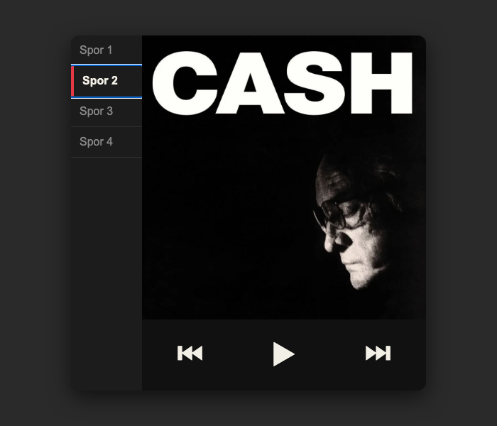

Oppgaven er delt i tre deler:

1. **Del 1 – Plassering.** Vi får alle boksene på riktig plass. Det er den viktigste delen.
2. **Del 2 – Innholdet i boksene.** Vi ordner det som ligger *inni* hver boks.
3. **Del 3 – Finpuss.** Farger, hover-effekter og andre detaljer som gjør det fint.

> **Tips:** Lagre og oppdater nettleseren etter *hvert* steg. Da ser du nøyaktig hva hver enkelt kodelinje gjør.

---

## Steg 0: Tenk i bokser

Før vi skriver én eneste linje kode, ser vi på det ferdige resultatet og spør: *Hvilke bokser består dette av?*

```
┌──────────────────────── body (hele nettleservinduet) ────────────────────────┐
│                                                                              │
│                ┌──────────── main (selve spilleren) ────────────┐            │
│                │ ┌──────────┐ ┌────────────────────────────────┐│            │
│                │ │          │ │                                ││            │
│                │ │ spille-  │ │           albumbilde           ││            │
│                │ │ liste    │ │                                ││            │
│                │ │          │ │                                ││            │
│                │ │ Spor 1   │ │                                ││            │
│                │ │ Spor 2   │ └────────────────────────────────┘│            │
│                │ │ Spor 3   │ ┌────────────────────────────────┐│            │
│                │ │ Spor 4   │ │      ⏮       ▶       ⏭        ││            │
│                │ │          │ │           spiller              ││            │
│                │ └──────────┘ └────────────────────────────────┘│            │
│                └────────────────────────────────────────────────┘            │
│                                                                              │
└──────────────────────────────────────────────────────────────────────────────┘
```

Vi ser at:

1. Det er **én stor boks** (`main`) som ligger midt på siden. → Det løser vi med **flexbox**, som du kan fra før.
2. Inni den store boksen er det **tre mindre bokser**: spillelisten, albumbildet og spilleren. Spillelisten går over hele høyden til venstre, mens albumbildet og spilleren ligger over hverandre til høyre. → Det løser vi med **grid**.
3. Inni spillelisten ligger sporene **under hverandre**, og inni spilleren ligger knappene **ved siden av hverandre**. → Det løser vi med **flexbox** igjen.

Huskeregel: **Grid for oppsettet, flexbox for innholdet.**

---

# Del 1 – Plassering

## Steg 1: HTML – lag boksene

Vi starter med HTML-en. Legg merke til at strukturen er nøyaktig den samme som i skissen: én `main` med tre bokser inni.

**index.html**

```html
<!DOCTYPE html>
<html lang="no">
<head>
    <meta charset="UTF-8">
    <meta name="viewport" content="width=device-width, initial-scale=1.0">
    <title>Musikkspiller</title>
    <link rel="stylesheet" href="style.css">
</head>
<body>
    <main>
        <div id="spilleliste">
            <a href="#spor1" id="spor1">Spor 1</a>
            <a href="#spor2" id="spor2">Spor 2</a>
            <a href="#spor3" id="spor3">Spor 3</a>
            <a href="#spor4" id="spor4">Spor 4</a>
        </div>
        
        <div id="spiller">
            <a href="#">⏮︎</a>
            <a href="#">▶︎</a>
            <a href="#">⏭︎</a>
        </div>
    </main>
</body>
</html>
```

Hver boks har fått en `id`, slik at vi kan finne den igjen i CSS-en (`#spilleliste`, `#albumArt`, `#spiller`). Lenkene i spillelisten har også fått hver sin `id`. Den bruker vi helt til slutt i steg 12.

Lag også en tom fil som heter `style.css`.

**Slik ser det ut nå:**

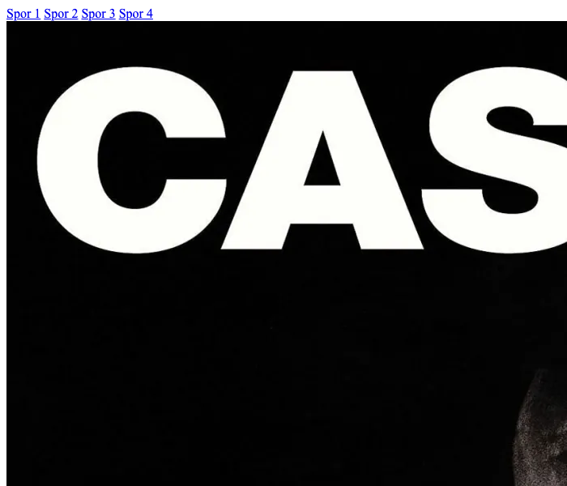

Ikke pent! Albumbildet er 1024 × 1024 piksler og tar over hele siden. Det er helt normalt – uten CSS vet ikke nettleseren hvor stort noe skal være.

---

## Steg 2: Gi hovedboksen en størrelse

Først bestemmer vi hvor stor spilleren skal være: 500 × 500 piksler. Vi gir den hvit bakgrunn og siden grå bakgrunn, slik at vi ser hvor boksen er.

Vi sier også at bildet skal fylle boksen det ligger i, i stedet for å være 1024 piksler bredt.

**style.css**

```css
body {
    background-color: lightgray;
}

main {
    width: 500px;
    height: 500px;
    background-color: white;
}

#albumArt {
    width: 100%;        /* like bred som boksen bildet ligger i */
    height: 100%;       /* like høy som boksen bildet ligger i */
    object-fit: cover;  /* klipp bildet heller enn å strekke det */
}
```

`width: 100%` betyr «like bred som forelderen». Akkurat nå er forelderen `main`, så bildet blir 500 piksler bredt. Senere, når vi har laget et rutenett, er det *ruten* som blir forelderen – og da passer bildet seg automatisk inn i den. Samme kode, nytt resultat!

**Slik ser det ut nå:**

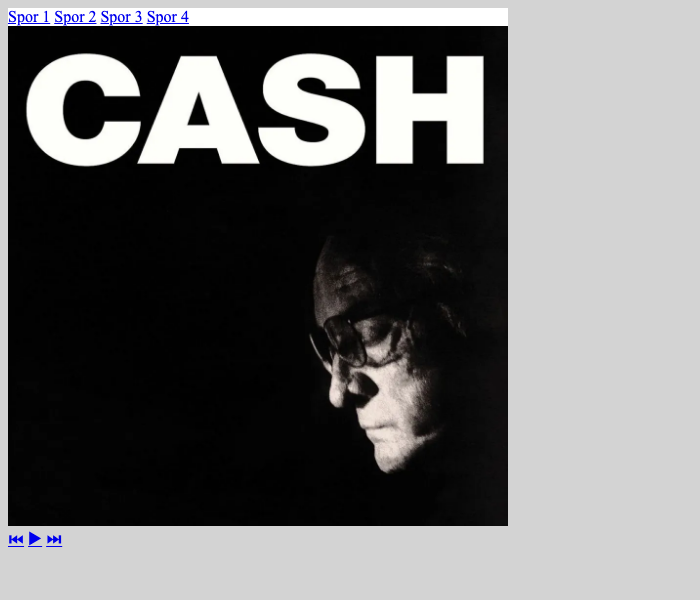

Den hvite boksen er der, men den ligger oppe i venstre hjørne. Og innholdet stikker ut nederst, fordi lenker + et bilde på 500 piksler + knapper til sammen er høyere enn 500 piksler. Det fikser vi i steg 4.

---

## Steg 3: Midtstill hovedboksen med flexbox

For å midtstille en boks gjør vi forelderen (`body`) til en flexboks. Men først må `body` være like høy som hele vinduet – ellers er det ingen plass å midtstille i.

```
   Før: body er bare så høy som innholdet        Etter: body er like høy som vinduet

   ┌─────────── vindu ───────────┐               ┌─────────── vindu ───────────┐
   │┌──── body ───┐              │               │┌────────── body ──────────┐│
   ││ ┌─ main ─┐  │              │               ││                          ││
   ││ │        │  │              │               ││        ┌─ main ─┐        ││
   ││ └────────┘  │              │               ││        │        │        ││
   │└─────────────┘              │               ││        └────────┘        ││
   │                             │               ││                          ││
   └─────────────────────────────┘               │└──────────────────────────┘│
                                                 └────────────────────────────┘
```

Bytt ut `body`-regelen fra steg 2 med dette:

```css
html, body {
    margin: 0;          /* fjern standardmargen nettleseren legger til */
    padding: 0;
    height: 100vh;      /* 100vh = 100 % av høyden på vinduet */
}

body {
    display: flex;
    justify-content: center;   /* midtstill bortover */
    align-items: center;       /* midtstill nedover */
    background-color: lightgray;
}
```

- `justify-content` styrer **hovedretningen** til flexboksen. Den er bortover som standard.
- `align-items` styrer **retningen på tvers**, altså nedover.

Bruker du begge med `center`, havner innholdet midt i boksen.

**Slik ser det ut nå:**

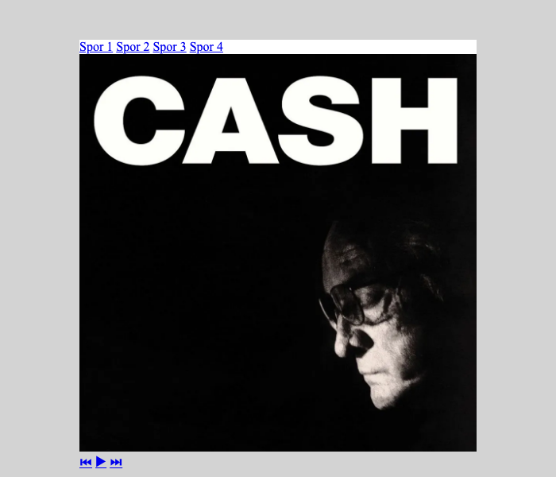

Spilleren ligger midt på siden. Innholdet stikker fortsatt ut nederst, men det er det neste steg som fikser.

---

## Steg 4: Del opp hovedboksen med grid

Nå skal vi dele `main` opp i ruter. Vi trenger **2 kolonner** og **2 rader**:

```
         100px              1fr (resten = 400px)
     ◄───────────►◄──────────────────────────────►
   ▲ ┌────────────┬───────────────────────────────┐
   │ │            │                               │
400px│   rute 1   │            rute 2             │
   │ │            │                               │
   ▼ ├────────────┼───────────────────────────────┤
auto │   rute 3   │            rute 4             │  ◄ 100px (resten)
     └────────────┴───────────────────────────────┘
```

Legg til dette i `main`-regelen:

```css
main {
    width: 500px;
    height: 500px;
    background-color: white;

    display: grid;
    grid-template-columns: 100px 1fr;
    grid-template-rows: 400px auto;
}
```

Slik leser du linjene:

- `display: grid;` – nå er `main` et rutenett, og de tre boksene inni blir plassert i rutene.
- `grid-template-columns: 100px 1fr;` – to kolonner. Den første er 100 piksler. Den andre er `1fr`, som betyr «én del av plassen som er igjen». Boksen er 500 piksler bred, så det blir 500 − 100 = **400 piksler** igjen.
- `grid-template-rows: 400px auto;` – to rader. Den første er 400 piksler. Den andre er `auto`, og siden `main` har en fast høyde på 500 piksler, får den resten: **100 piksler**.

> **Hvorfor `fr` og ikke prosent?** `fr` regnes ut *etter* at de faste størrelsene er trukket fra, så det går alltid opp. Med `100px 80%` går det bare opp så lenge boksen er nøyaktig 500 piksler bred. Endrer du bredden til 600 piksler, blir det 100 + 480 = 580 – og 20 piksler står tomme. Med `100px 1fr` blir den andre kolonnen automatisk 500 piksler.

For å *se* rutene gir vi boksene midlertidige bakgrunnsfarger. Legg til:

```css
#spilleliste {
    background-color: lightblue;    /* midlertidig */
}

#spiller {
    background-color: lightgreen;   /* midlertidig */
}
```

> **Tips:** Fargelegg alltid boksene mens du bygger oppsettet. Det er den enkleste måten å se hva som skjer. Fargene fjerner vi i del 3.

**Slik ser det ut nå:**

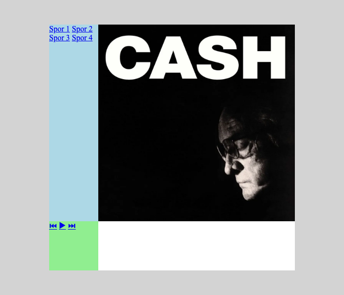

Rutenettet er der, og innholdet stikker ikke lenger ut. Men spilleren (grønn) har havnet **nede til venstre**, og den hvite ruten nede til høyre er tom. Hvorfor?

Når vi ikke sier noe om *hvor* boksene skal ligge, fyller grid rutene **i rekkefølge**, slik du leser en bok: bortover først, så neste rad. Boksene kommer i samme rekkefølge som i HTML-en:

```
┌──────────────┬───────────────┐
│ 1. spille-   │ 2. albumArt   │
│    liste     │               │
├──────────────┼───────────────┤
│ 3. spiller   │   (tom)       │
└──────────────┴───────────────┘
```

Det er ikke det vi vil. Spillelisten skal gå over begge radene. Det fikser vi i neste steg.

---

## Steg 5: Gi rutene navn med `grid-template-areas`

Vi kan «tegne» oppsettet direkte i CSS-en ved å gi rutene navn. Hver tekstlinje er én rad, og hvert ord er én kolonne:

```
"spilleliste album"      ← rad 1: kolonne 1 heter spilleliste, kolonne 2 heter album
"spilleliste spiller"    ← rad 2: kolonne 1 heter spilleliste, kolonne 2 heter spiller
```

Fordi `spilleliste` står i **begge** radene, strekker den boksen seg over begge:

```
┌──────────────┬───────────────┐
│              │    album      │
│ spilleliste  │               │
│              ├───────────────┤
│              │   spiller     │
└──────────────┴───────────────┘
```

Legg til `grid-template-areas` i `main`:

```css
main {
    width: 500px;
    height: 500px;
    background-color: white;

    display: grid;
    grid-template-columns: 100px 1fr;
    grid-template-rows: 400px auto;
    grid-template-areas:
        "spilleliste album"
        "spilleliste spiller";
}
```

Til slutt må hver boks få vite hvilket område den skal ligge i. Det gjør vi med `grid-area`:

```css
#spilleliste {
    grid-area: spilleliste;
    background-color: lightblue;    /* midlertidig */
}

#albumArt {
    grid-area: album;
    width: 100%;
    height: 100%;
    object-fit: cover;
}

#spiller {
    grid-area: spiller;
    background-color: lightgreen;   /* midlertidig */
}
```

> **Tallene må stemme:** 2 tekstlinjer i `grid-template-areas` krever 2 verdier i `grid-template-rows`. 2 ord per linje krever 2 verdier i `grid-template-columns`.

**Slik ser det ut nå:**

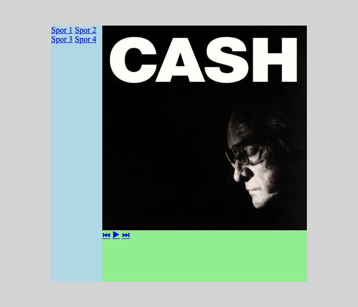

Alle boksene ligger der de skal. **Det er hele oppsettet** – resten handler om hva som skjer *inni* boksene.

---

# Del 2 – Innholdet i boksene

## Steg 6: Spillelisten – sporene under hverandre

Lenker er *inline*-elementer. Det betyr at de legger seg etter hverandre på samme linje, som ord i en setning. Det ser du i bildet fra steg 5: «Spor 1 Spor 2» står på én linje.

Vi vil ha dem under hverandre. Da gjør vi spillelisten til en flexboks med retning **nedover**:

```
 flex-direction: row (standard)         flex-direction: column
 ┌──────────────────────────────┐       ┌──────────┐
 │ Spor 1  Spor 2  Spor 3  …    │       │ Spor 1   │
 └──────────────────────────────┘       │ Spor 2   │
                                        │ Spor 3   │
                                        │ Spor 4   │
                                        └──────────┘
```

```css
#spilleliste {
    grid-area: spilleliste;
    background-color: lightblue;    /* midlertidig */

    display: flex;
    flex-direction: column;
}
```

**Slik ser det ut nå:**

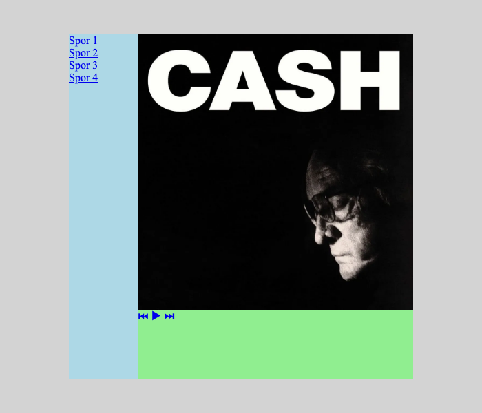

Et ekstra poeng: Inne i en flexboks med `column` blir hver lenke **like bred som hele spillelisten**. Det betyr at hele raden blir klikkbar, ikke bare teksten. Det får vi bruk for i steg 9.

---

## Steg 7: Spilleren – knappene ved siden av hverandre

Knappene skal ligge bortover, med lik avstand, og midt i boksen i høyden. Det er flexboks igjen, nå med standardretningen (bortover):

```
 justify-content: space-around
 ┌────────────────────────────────────────┐
 │                                        │  ▲
 │     ⏮            ▶            ⏭       │  │ align-items: center
 │                                        │  ▼
 └────────────────────────────────────────┘
   ◄──►  ◄──────►     ◄──────►     ◄──►
   lik plass rundt hver knapp
```

```css
#spiller {
    grid-area: spiller;
    background-color: lightgreen;   /* midlertidig */

    display: flex;
    justify-content: space-around;  /* fordel knappene bortover */
    align-items: center;            /* midtstill i høyden */
    font-size: 2.5rem;              /* større knapper */
}
```

`space-around` gir lik plass *rundt* hver knapp. Prøv også `space-between` (ingen plass ytterst) og `space-evenly` (helt lik plass overalt) og se forskjellen!

**Slik ser det ut nå:**

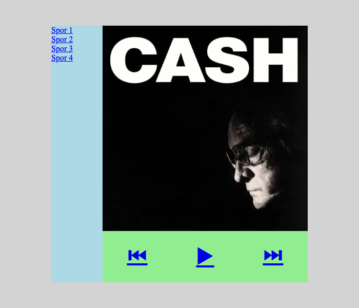

**Nå er all plasseringen ferdig.** Resten av oppgaven handler om utseende.

---

# Del 3 – Finpuss

## Steg 8: Farger

Vi henter fargene fra albumcoveret: svart og kremhvitt, med rødt som én aksentfarge. Det er lurt å skrive fargepaletten som en kommentar øverst i CSS-filen, så du har den for hånden:

```css
/* Fargepalett
   Bakgrunn side:   #2a2a2a  (mørk grå)
   Spiller:         #111111  (nesten svart, som coveret)
   Spilleliste:     #1c1c1c  (litt lysere svart)
   Tekst:           #f2efe6  (kremhvit, som «CASH»)
   Dempet tekst:    #8a8a8a  (grå)
   Aksent:          #e63946  (rød)
*/
```

Bytt ut de midlertidige fargene:

| Hvor | Før | Etter |
|---|---|---|
| `body` | `lightgray` | `#2a2a2a` |
| `main` | `white` | `#111111` |
| `#spilleliste` | `lightblue` | `#1c1c1c` |
| `#spiller` | `lightgreen` | *(fjern linjen – da ser vi fargen til `main`)* |

Legg også til en skrifttype i `body`:

```css
body {
    display: flex;
    justify-content: center;
    align-items: center;
    background-color: #2a2a2a;
    font-family: Arial, Helvetica, sans-serif;
}
```

**Slik ser det ut nå:**

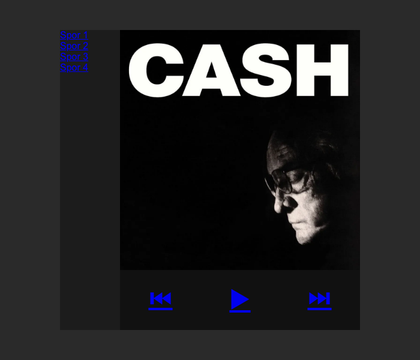

Mye mørkere og finere – men lenkene er blå og understreket, og nesten umulige å lese. Det fikser vi i de neste stegene.

---

## Steg 9: Spillelisten – få lenkene til å se ut som rader

Lenker får blå farge og understrek fra nettleseren. Vi overstyrer det, gir dem luft og en tynn strek mellom hvert spor:

```css
#spilleliste a {
    padding: 0.75rem;                 /* luft rundt teksten */
    border-bottom: 1px solid #2f2f2f; /* strek mellom sporene */
    color: #8a8a8a;                   /* dempet grå tekst */
    text-decoration: none;            /* fjern understreken */
}

#spilleliste a:hover {
    color: #f2efe6;                   /* teksten lyser opp når musen er over */
    background-color: #262626;
}
```

`#spilleliste a` betyr «alle lenker som ligger *inni* `#spilleliste`». Da påvirker vi ikke knappene i spilleren, som også er lenker.

**Slik ser det ut nå:**

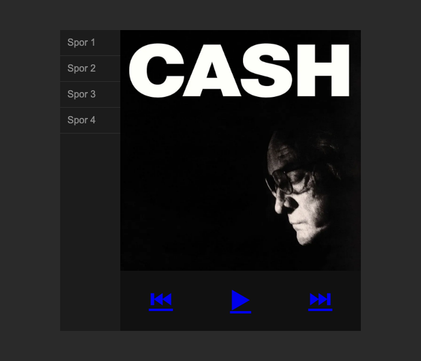

---

## Steg 10: Spilleren – knappene

Samme triks for knappene: fjern den blå fargen og understreken. Vi legger også til en hover-effekt der knappen blir rød og litt større:

```css
#spiller a {
    padding: 1rem;
    color: #f2efe6;                   /* kremhvit */
    text-decoration: none;            /* fjern understreken */
}

#spiller a:hover {
    color: #e63946;                   /* rød når musen er over */
    transform: scale(1.2);            /* 20 % større */
}
```

> **Hvorfor fungerer ikke `color` på knappene mine?** Symbolene ⏮ ▶ ⏭ kan vises på to måter: som *emoji* (fargelagte, f.eks. blå bokser på Mac) eller som *tekst*. Emojier har sine egne farger, og da virker ikke `color`. Bak hvert symbol i HTML-en vår står et usynlig tegn som ber nettleseren vise det som tekst. Har du kopiert symbolene fra et annet sted og de fortsatt er blå bokser, kan du skrive dem slik i stedet: `&#x23EE;&#xFE0E;` (⏮), `&#x25B6;&#xFE0E;` (▶) og `&#x23ED;&#xFE0E;` (⏭).

> **Visste du?** `transform` virker vanligvis ikke på lenker, fordi de er inline-elementer. Her virker det likevel, fordi lenkene ligger inni en flexboks – og da blir de behandlet som blokker.

**Slik ser det ut nå:**


---

## Steg 11: Runde hjørner og skygge

To små detaljer som gjør at spilleren ser ut som en egen gjenstand som «svever» over bakgrunnen. Legg til i `main`:

```css
main {
    /* … det som står der fra før … */

    border-radius: 12px;                          /* runde hjørner */
    overflow: hidden;                             /* så innholdet følger hjørnene */
    box-shadow: 0 10px 30px rgba(0, 0, 0, 0.6);   /* skygge under spilleren */
}
```

Uten `overflow: hidden` ville albumbildet og spillelisten stukket ut over de runde hjørnene – de er jo firkantede.

`box-shadow` leses slik: `0` (ingen forskyvning sidelengs), `10px` (10 piksler ned), `30px` (hvor uskarp skyggen er), og til slutt fargen – svart med 60 % synlighet.

**Slik ser det ut nå:**

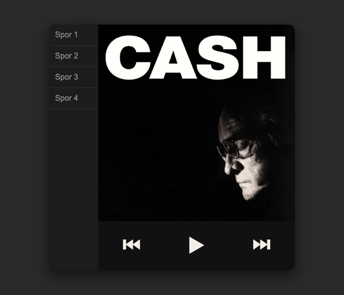

---

## Steg 12: Vis hvilket spor som er valgt – uten JavaScript

Når vi klikker på et spor, vil vi at det skal *bli stående* markert. Det kan vi få til med pseudoklassen `:target`.

Husk fra steg 1 at hver lenke peker på sin egen `id`:

```html
<a href="#spor2" id="spor2">Spor 2</a>
```

Slik fungerer det:

1. Du klikker på «Spor 2».
2. Adressen i nettleseren blir `index.html#spor2`.
3. `:target` treffer elementet med `id="spor2"` – altså lenken du nettopp klikket på.

```css
#spilleliste a:target {
    color: #f2efe6;                   /* kremhvit tekst */
    font-weight: bold;                /* fet skrift */
    border-left: 4px solid #e63946;   /* rød strek på venstre side */
}
```

**Slik ser det ut nå** (etter å ha klikket på spor 2):


Ting som er greie å vite:

- **Når siden lastes, er ingen spor valgt**, fordi det ikke står noe etter `#` i adressen.
- **Tilbake-knappen i nettleseren flytter markeringen**, fordi hvert klikk lager et nytt steg i historikken. Prøv!
- **Den blå rammen** rundt spor 2 viser hvilket element tastaturet står på. Den forsvinner når du klikker et annet sted, og skal være der for dem som bruker tastatur til å navigere.
- **Ser du ingen endring?** Trykk **Cmd + Shift + R** (Mac) eller **Ctrl + Shift + R** (Windows) for å laste siden på nytt uten at nettleseren bruker en gammel lagret versjon av CSS-filen.

---

## Oppsummering

| Hva | Verktøy | Viktigste linjer |
|---|---|---|
| Spilleren midt på siden | Flexbox på `body` | `display: flex; justify-content: center; align-items: center;` |
| Dele spilleren i ruter | Grid på `main` | `grid-template-columns`, `grid-template-rows`, `grid-template-areas` |
| Legge boksene i rutene | Grid på hver boks | `grid-area: navn;` |
| Sporene under hverandre | Flexbox på `#spilleliste` | `flex-direction: column;` |
| Knappene ved siden av hverandre | Flexbox på `#spiller` | `justify-content: space-around; align-items: center;` |
| Valgt spor | Pseudoklasse | `:target` |

**Grid for oppsettet, flexbox for innholdet.**

---

## Ferdig kode

**style.css**

```css
/* Fargepalett
   Bakgrunn side:   #2a2a2a  (mørk grå)
   Spiller:         #111111  (nesten svart, som coveret)
   Spilleliste:     #1c1c1c  (litt lysere svart)
   Tekst:           #f2efe6  (kremhvit, som «CASH»)
   Dempet tekst:    #8a8a8a  (grå)
   Aksent:          #e63946  (rød)
*/

html, body {
    margin: 0;
    padding: 0;
    height: 100vh;
}

body {
    display: flex;
    justify-content: center;
    align-items: center;

    background-color: #2a2a2a;
    font-family: Arial, Helvetica, sans-serif;
}

main {
    background-color: #111111;
    width: 500px;
    height: 500px;

    border-radius: 12px;
    overflow: hidden;
    box-shadow: 0 10px 30px rgba(0, 0, 0, 0.6);

    display: grid;
    grid-template-columns: 100px 1fr;
    grid-template-rows: 400px auto;
    grid-template-areas:
        "spilleliste album"
        "spilleliste spiller";
}

/* Spillelisten */
#spilleliste {
    grid-area: spilleliste;
    background-color: #1c1c1c;

    display: flex;
    flex-direction: column;
}

#spilleliste a {
    padding: 0.75rem;
    border-bottom: 1px solid #2f2f2f;
    color: #8a8a8a;
    text-decoration: none;
}

#spilleliste a:hover {
    color: #f2efe6;
    background-color: #262626;
}

#spilleliste a:target {
    color: #f2efe6;
    font-weight: bold;
    border-left: 4px solid #e63946;
}

/* Albumbildet */
#albumArt {
    grid-area: album;
    width: 100%;
    height: 100%;
    object-fit: cover;
}

/* Spilleren */
#spiller {
    grid-area: spiller;

    display: flex;
    justify-content: space-around;
    align-items: center;
    font-size: 2.5rem;
}

#spiller a {
    padding: 1rem;
    color: #f2efe6;
    text-decoration: none;
}

#spiller a:hover {
    color: #e63946;
    transform: scale(1.2);
}
```
