# Vi lager en responsiv nettside – steg for steg

En **responsiv** nettside er en side som ser bra ut og er lett å bruke, uansett om du åpner den på mobil, nettbrett eller en stor PC-skjerm. I denne oppgaven bygger vi en nettside for en turklubb, og gjør den responsiv bit for bit.

Slik ser det ferdige resultatet ut. Det er **samme HTML og samme CSS** i begge bildene:

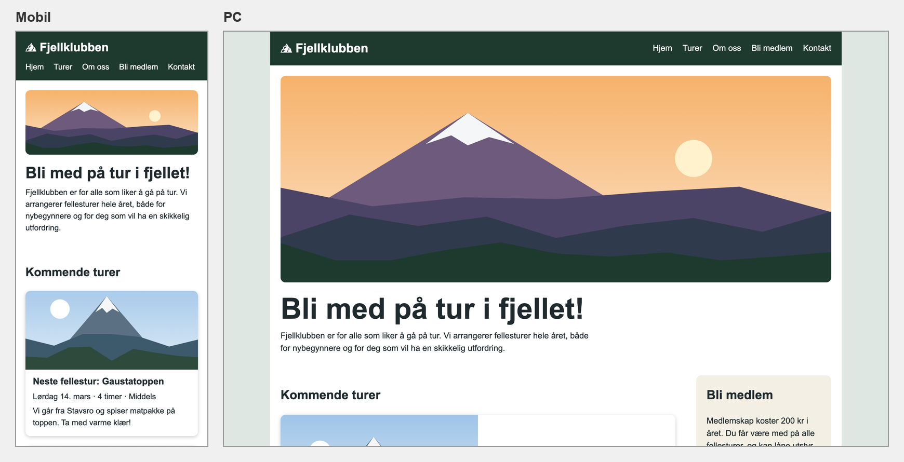

Du trenger det du har lært fra før: flexbox (som i menyen i [CSS-guiden](../guide%20-%20css.md#en-enkel-meny-med-flexbox)) og grid (som i [musikkspilleren](../musikkspiller-eksempel/README.md)).

> **Tips:** Lagre og oppdater nettleseren etter *hvert* steg. Gjør nettleservinduet smalt og bredt, eller bruk mobilvisningen i utviklerverktøyene (se [steg 9](#steg-9-test-siden-på-ordentlig)). Da ser du nøyaktig hva hver kodelinje gjør.

---

## Steg 0: Tre verktøy, i denne rekkefølgen

Mange tror at responsivt design betyr «skriv masse media queries». Det stemmer ikke helt lenger. Moderne CSS er laget slik at mye tilpasser seg skjermen **av seg selv**. Vi bruker tre verktøy, i denne rekkefølgen:

| | Verktøy | Når? | Eksempler |
|---|---|---|---|
| **1** | **La innholdet tilpasse seg selv** | Alltid først | `max-width: 100%`, `flex-wrap: wrap`, `repeat(auto-fit, minmax(...))`, `clamp()` |
| **2** | **Media queries** | Når *oppsettet* av hele siden skal endres | `@media (min-width: 800px) { ... }` |
| **3** | **Container queries** *(bonus)* | Når en *boks* skal endre seg etter hvor mye plass den har fått | `@container (min-width: 600px) { ... }` |

Huskeregel: **Prøv å la ting tilpasse seg selv først. Bruk media query når oppsettet må endres.**

Vi skal også jobbe **mobil først**. Det betyr at vi lager mobilversjonen først, og så legger til ting når skjermen blir bredere. Mobilversjonen er nemlig den enkleste: Alt ligger under hverandre i én kolonne, akkurat slik HTML gjør helt av seg selv.

```
        Mobil                                  PC
┌──────────────────┐     ┌────────────────────────────────────────┐
│     header       │     │                header                  │
├──────────────────┤     ├────────────────────────────────────────┤
│                  │     │                                        │
│      hero        │     │                 hero                   │
│                  │     │                                        │
├──────────────────┤     ├──────────────────────────────┬─────────┤
│                  │     │                              │         │
│      main        │     │            main              │  aside  │
│   (kortene)      │     │         (kortene)            │         │
│                  │     │                              │         │
├──────────────────┤     │                              │         │
│      aside       │     │                              │         │
├──────────────────┤     ├──────────────────────────────┴─────────┤
│     footer       │     │                footer                  │
└──────────────────┘     └────────────────────────────────────────┘
```

---

# Del 1 – La innholdet tilpasse seg selv

## Steg 1: HTML

Lag en mappe med `index.html`, en tom `style.css` og en mappe `bilder/` med bildene fra [bilder](bilder/).

**index.html**

```html
<!DOCTYPE html>
<html lang="no">
<head>
    <meta charset="UTF-8">
    <meta name="viewport" content="width=device-width, initial-scale=1.0">
    <title>Fjellklubben</title>
    <link rel="stylesheet" href="style.css">
</head>
<body>
    <header>
        <a href="index.html" class="logo">⛰ Fjellklubben</a>
        <nav>
            <a href="#">Hjem</a>
            <a href="#">Turer</a>
            <a href="#">Om oss</a>
            <a href="#">Bli medlem</a>
            <a href="#">Kontakt</a>
        </nav>
    </header>

    <section class="hero">
        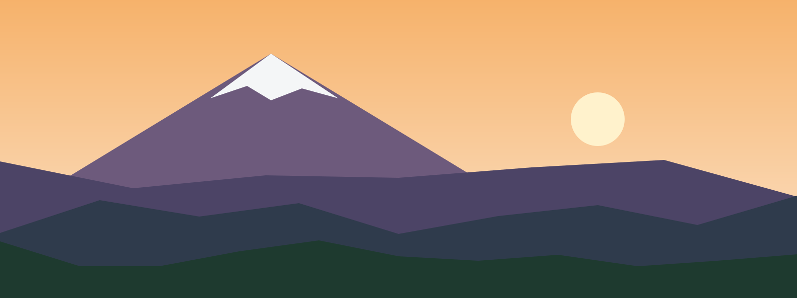
        <h1>Bli med på tur i fjellet!</h1>
        <p>Fjellklubben er for alle som liker å gå på tur. Vi arrangerer fellesturer hele året, både for nybegynnere og for deg som vil ha en skikkelig utfordring.</p>
    </section>

    <main>
        <h2>Kommende turer</h2>
        <div class="kort-liste">
            <article class="kort fremhevet">
                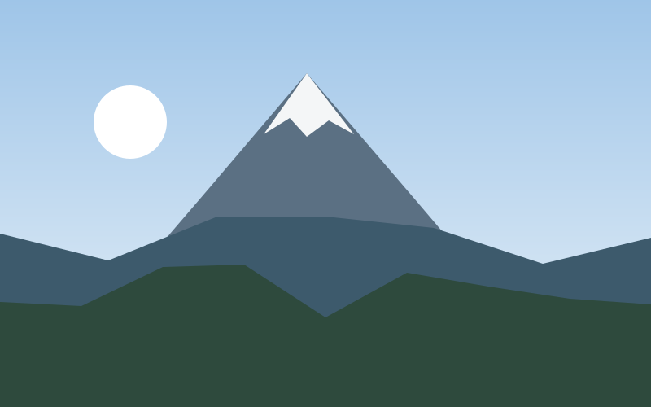
                <div class="kort-tekst">
                    <h3>Neste fellestur: Gaustatoppen</h3>
                    <p>Lørdag 14. mars · 4 timer · Middels</p>
                    <p>Vi går fra Stavsro og spiser matpakke på toppen. Ta med varme klær!</p>
                </div>
            </article>
            <article class="kort">
                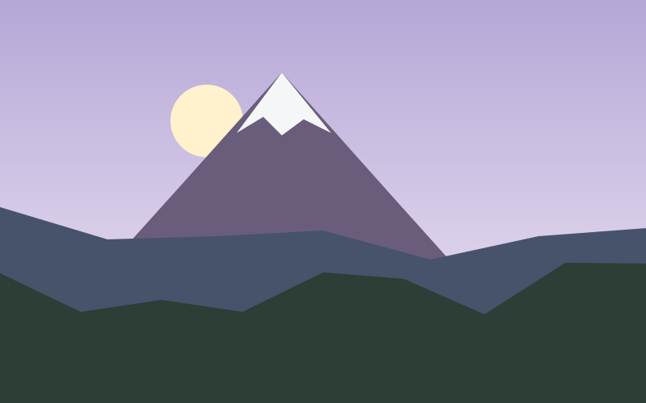
                <div class="kort-tekst">
                    <h3>Besseggen</h3>
                    <p>Lørdag 11. april · 7 timer · Krevende</p>
                </div>
            </article>
            <!-- ... fire kort til, på samme måte: trolltunga, galdhopiggen, romsdalseggen, kjerag -->
        </div>
    </main>

    <aside>
        <h2>Bli medlem</h2>
        <p>Medlemskap koster 200 kr i året. Du får være med på alle fellesturer, og kan låne utstyr gratis.</p>
        <a href="#" class="knapp">Meld deg inn</a>
    </aside>

    <footer>
        <p>© 2026 Fjellklubben</p>
    </footer>
</body>
</html>
```

Hele HTML-filen med alle seks kortene finner du i [index.html](index.html). Det første kortet har en ekstra klasse, `fremhevet`. Den bruker vi først i bonussteget helt til slutt.

Legg merke til denne linjen i `<head>`:

```html
<meta name="viewport" content="width=device-width, initial-scale=1.0">
```

Den forteller mobilen: «Denne siden er laget for mobil, ikke lat som om skjermen er en PC-skjerm.» **Uten den virker ingenting av det vi gjør i denne oppgaven på en ekte mobil.** Den er med i grunnmalen du får når du skriver `!` + Tab i VS Code. I [steg 9](#steg-9-test-siden-på-ordentlig) ser du hva som skjer uten den.

**Slik ser det ut nå:**

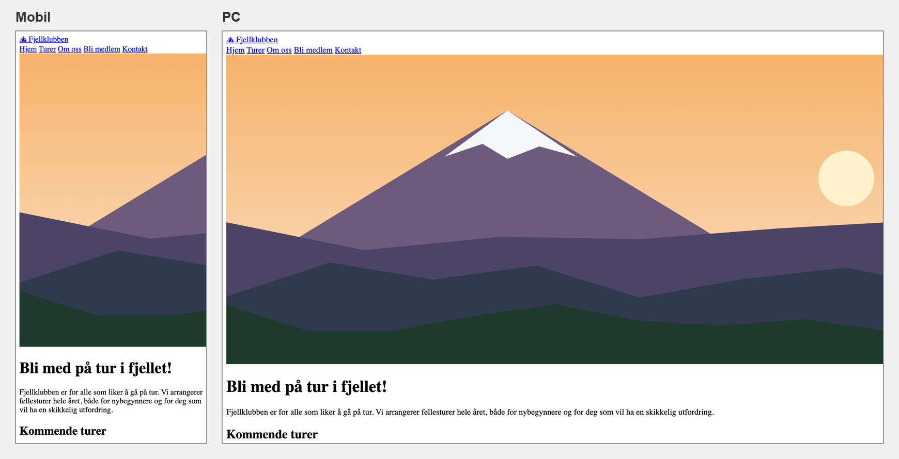

Faktisk er HTML **responsivt helt av seg selv**: Teksten brytes pent på mobilen, og alt ligger under hverandre. Det er bare én ting som er galt: Bildet er 1600 piksler bredt og stikker langt ut til høyre på mobilen. Da kan hele siden scrolles sidelengs, og det er det første tegnet på en side som ikke er responsiv.

---

## Steg 2: Grunnoppsett og bilder som krymper

Vi starter med noen grunnregler. Den viktigste er regelen for `img`:

**style.css**

```css
* {
    box-sizing: border-box;
}

body {
    margin: 0;
    font-family: Arial, Helvetica, sans-serif;
    line-height: 1.5;
    color: #1f2a2e;
}

img {
    max-width: 100%;   /* aldri bredere enn boksen bildet ligger i */
    height: auto;      /* behold forholdet mellom bredde og høyde */
    display: block;    /* fjerner et lite mellomrom under bildet */
}
```

`max-width: 100%` betyr «du får være så stor du vil, men **aldri bredere enn forelderen din**». På PC-en er det plass nok, og bildet blir stort. På mobilen krymper bildet så det passer.

> **`width` eller `max-width`?** `width: 100%` *tvinger* bildet til å bli like bredt som boksen, også når bildet egentlig er lite. Da kan små bilder bli store og uskarpe. `max-width: 100%` lar bildet krympe, men aldri vokse forbi sin egen størrelse.

Resten er luft og farger, så vi ser boksene:

```css
.hero,
main,
aside,
footer {
    padding: 20px;
}

.hero img {
    border-radius: 10px;
}

.hero p {
    max-width: 600px;   /* lange tekstlinjer er tunge å lese */
    margin: 0;
}

aside {
    background-color: #f3efe4;
    border-radius: 10px;
    margin: 20px;
}

aside h2 {
    margin-top: 0;
}

.knapp {
    display: inline-block;
    padding: 10px 20px;
    border-radius: 5px;
    background-color: #e07a2e;
    color: white;
    font-weight: bold;
    text-decoration: none;
}

footer {
    background-color: #1e3a2f;
    color: white;
    text-align: center;
}
```

> **Visste du?** `.hero p` har fått `max-width: 600px` av samme grunn: På en bred skjerm blir tekstlinjene ellers så lange at øynene mister tråden når de skal hoppe til neste linje.

**Slik ser det ut nå:**

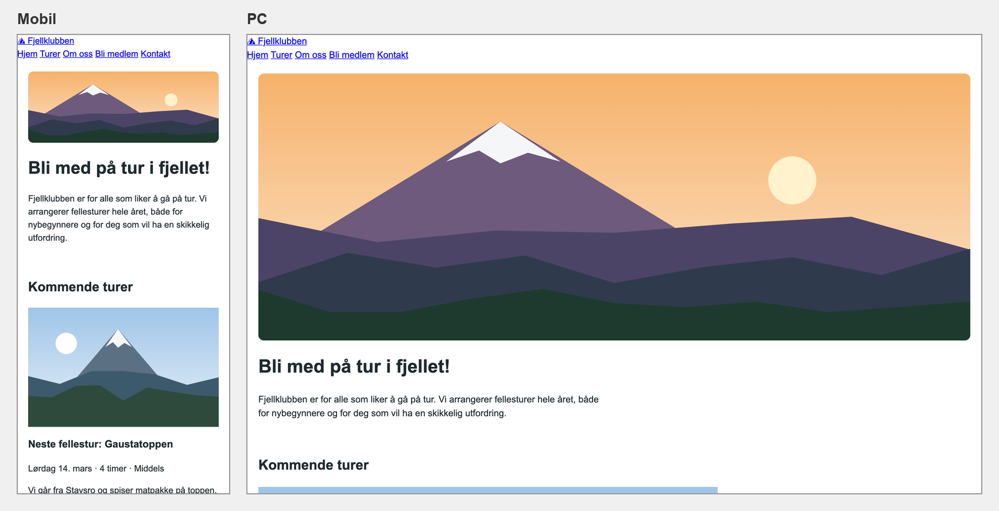

Bildet passer på mobilen, og siden kan ikke lenger scrolles sidelengs. Menyen øverst er fortsatt bare blå lenker. Den fikser vi nå.

---

## Steg 3: Menyen – `flex-wrap`

Menyen lager vi med flexbox, slik du har gjort før: logo til venstre og lenker til høyre.

```css
header {
    display: flex;
    justify-content: space-between;   /* logo til venstre, nav til høyre */
    align-items: center;
    padding: 15px 20px;
    background-color: #1e3a2f;
}

header a {
    color: white;
    text-decoration: none;
}

.logo {
    font-size: 1.5rem;
    font-weight: bold;
}

nav {
    display: flex;
    gap: 20px;
}
```

På PC-en ser dette helt fint ut. Men se på mobilen (venstre bilde under): Det er ikke plass til alt på én linje. Flexbox prøver likevel å presse alt inn på samme linje. «Bli medlem» brekkes i to, og «Kontakt» har forsvunnet ut av skjermen.

Løsningen er én linje: `flex-wrap: wrap`. Den sier «hvis det ikke er plass, får du gå videre på neste linje». Legg den til både i `header` og i `nav`, og bytt ut `gap` slik at det blir litt luft mellom linjene også:

```css
header {
    display: flex;
    flex-wrap: wrap;          /* ny */
    justify-content: space-between;
    align-items: center;
    gap: 10px 30px;           /* ny: 10px mellom linjene, 30px bortover */
    padding: 15px 20px;
    background-color: #1e3a2f;
}

nav {
    display: flex;
    flex-wrap: wrap;          /* ny */
    gap: 5px 20px;            /* endret */
}
```

**Slik ser det ut nå** (mobil):

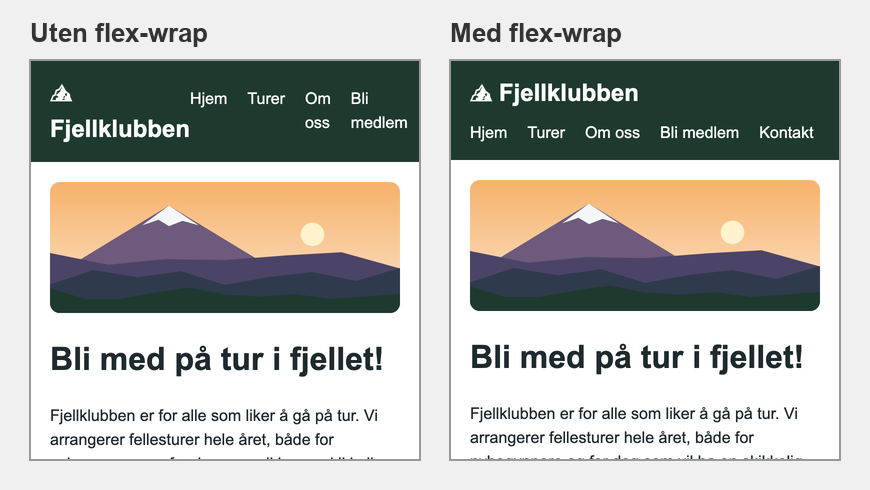

Når det ikke er plass ved siden av logoen, legger `nav` seg under. Blir skjermen *enda* smalere, går lenkene i `nav` over på flere linjer. På PC-en er alt som før. **Ingen media query trengs.**

---

## Steg 4: Kortene – grid som teller kolonner selv

Kortene skal ligge i et rutenett. Fra før kjenner du kanskje denne måten å gjøre det på:

```css
.kort-liste {
    display: grid;
    grid-template-columns: repeat(3, 1fr);   /* tre like brede kolonner */
    gap: 20px;
}

.kort {
    background-color: white;
    border-radius: 10px;
    overflow: hidden;                          /* bildet følger de runde hjørnene */
    box-shadow: 0 2px 8px rgba(0, 0, 0, 0.2);
}

.kort img {
    width: 100%;
    height: 160px;
    object-fit: cover;   /* klipp bildet heller enn å strekke det */
}

.kort-tekst {
    padding: 10px 15px;
}

.kort h3 {
    margin: 0 0 5px;
}

.kort p {
    margin: 0 0 5px;
}
```

Problemet er at `repeat(3, 1fr)` betyr «**alltid** tre kolonner». Det ser bra ut på PC, men på mobilen blir kortene så smale at teksten nesten ikke får plass (venstre bilde under).

Bytt ut `grid-template-columns` med denne linjen:

```css
.kort-liste {
    display: grid;
    grid-template-columns: repeat(auto-fit, minmax(250px, 1fr));
    gap: 20px;
}
```

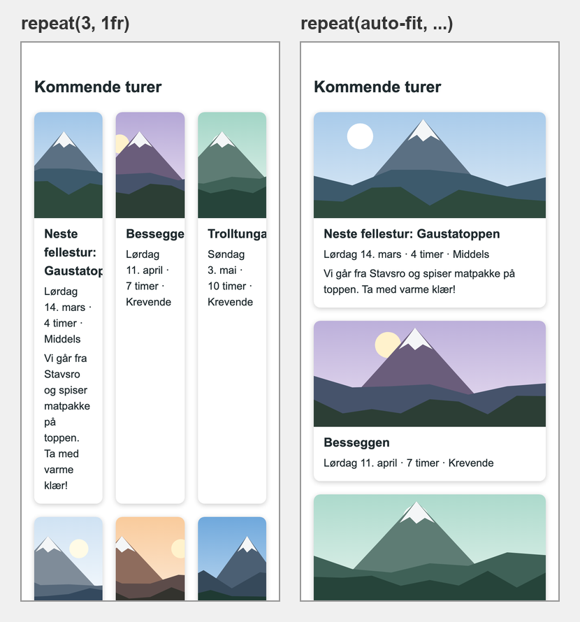

Slik leser du linjen, innenfra og ut:

- `minmax(250px, 1fr)` – hver kolonne er **minst** 250 piksler, og **høyst** én del av den ledige plassen.
- `repeat(auto-fit, ...)` – lag **så mange kolonner som får plass**.

Nettleseren regner altså ut selv hvor mange kolonner det blir plass til. Gjør vinduet bredere og smalere og se på kortene:

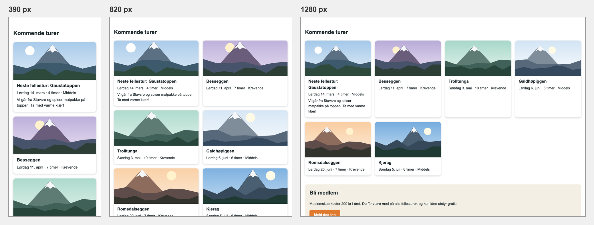

```
 390 px:  plass til 1 kolonne på 250px   →  [  kort  ]
 820 px:  plass til 3? nei, 2            →  [ kort ][ kort ]
1280 px:  plass til 4                    →  [kort][kort][kort][kort]
```

Én kodelinje, og **ingen media query**.

---

## Steg 5: En overskrift som vokser med skjermen – `clamp()`

Vi vil ha en stor, tydelig overskrift. På PC-en ser `3.5rem` (56 piksler) flott ut:

```css
.hero h1 {
    font-size: 3.5rem;
    line-height: 1.1;
    margin: 20px 0 10px;
}
```

Men på mobilen tar den nesten hele skjermen (venstre bilde under). Vi vil egentlig ha en *liten* overskrift på mobil og en *stor* på PC. Det løser `clamp()`:

```css
.hero h1 {
    font-size: clamp(2rem, 6vw, 3.5rem);
    line-height: 1.1;
    margin: 20px 0 10px;
}
```

`clamp()` tar tre verdier: **minst**, **helst** og **høyst**.

```
clamp( 2rem,       6vw,        3.5rem )
       ▲           ▲           ▲
       aldri       helst 6 %   aldri
       mindre      av skjerm-  større
       enn 32px    bredden     enn 56px
```

`vw` betyr *viewport width*, altså bredden på nettleservinduet. `6vw` er 6 % av bredden. På en mobil som er 390 piksler bred, blir det 23 piksler. Det er mindre enn minimum, så overskriften blir 32 piksler. På en PC blir 6 % mer enn 56 piksler, så den stopper på maksimum. Midt imellom vokser den jevnt med skjermen.

**Slik ser det ut nå** (mobil):

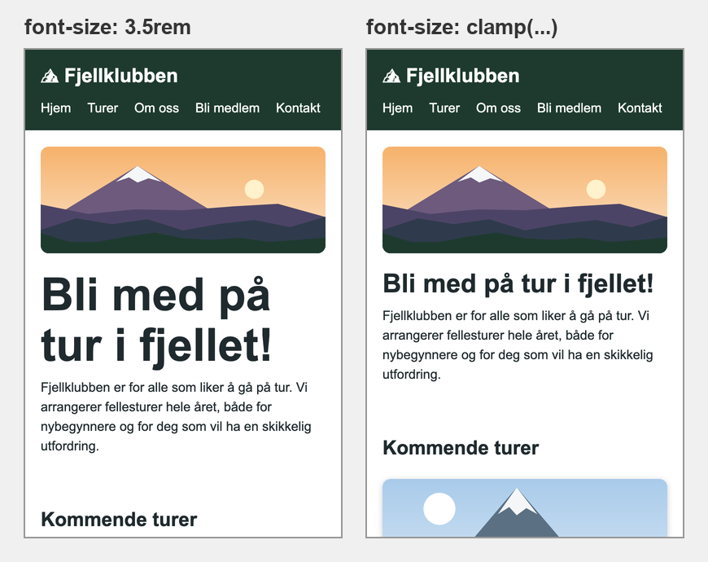

> **Visste du?** `clamp()` kan brukes på alt som har en størrelse, ikke bare tekst. For eksempel `padding: clamp(10px, 3vw, 40px);` gir lite luft på mobil og mer luft på PC.

---

## Steg 6: Ikke for bred på store skjermer – `max-width`

Responsivt handler ikke bare om små skjermer. På en stor skjerm blir siden nå veldig bred: Bildet blir kjempestort, og alt er spredt utover (venstre bilde under).

Vi gir `body` en **maksbredde**, og sentrerer den med `margin: 0 auto`. Gi også `html` en bakgrunnsfarge, så vi ser hvor siden slutter:

```css
html {
    background-color: #dfe7e2;
}

body {
    margin: 0 auto;          /* endret: auto til høyre og venstre sentrerer */
    max-width: 1100px;       /* ny */
    background-color: white; /* ny */
    font-family: Arial, Helvetica, sans-serif;
    line-height: 1.5;
    color: #1f2a2e;
}
```

**Slik ser det ut nå** (skjerm som er 1600 piksler bred):

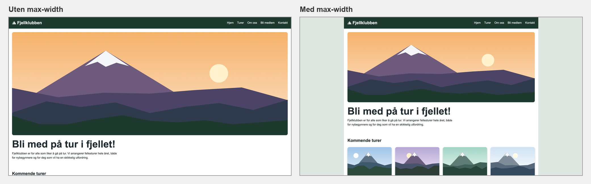

Igjen er det **`max-width` og ikke `width`**. `width: 1100px` ville gjort siden 1100 piksler bred også på mobilen, og da ville den stukket ut. `max-width: 1100px` betyr «så bred du vil, men ikke mer enn 1100».

> **Mønsteret går igjen:** `max-width` på bildene, `max-width` på teksten og `max-width` på hele siden. «Bli gjerne mindre, men ikke større enn ...» er kjernen i responsivt design.

---

# Del 2 – Når oppsettet må endres: media queries

## Steg 7: «Bli medlem» ved siden av kortene på PC

Alt så langt har tilpasset seg selv. Men nå vil vi gjøre noe som ikke kan skje av seg selv: Vi vil **endre oppsettet** for hele siden. På PC-en skal «Bli medlem»-boksen ligge til høyre for kortene, ikke under dem. Det er dette media queries er laget for.

Først gir vi hver del av siden et navn, med `grid-area`, akkurat som i musikkspilleren:

```css
header { grid-area: header; }
.hero  { grid-area: hero; }
main   { grid-area: main; }
aside  { grid-area: aside; }
footer { grid-area: footer; }
```

Så legger vi selve oppsettet **inni en media query**, nederst i CSS-filen:

```css
@media (min-width: 800px) {
    body {
        display: grid;
        grid-template-columns: 1fr 300px;
        grid-template-areas:
            "header header"
            "hero   hero"
            "main   aside"
            "footer footer";
    }

    aside {
        align-self: start;   /* ikke strekk boksen like høy som main */
    }
}
```

Slik leser du det:

- `@media (min-width: 800px)` betyr «reglene inni her gjelder **bare når vinduet er minst 800 piksler bredt**».
- Når vinduet er smalere enn 800 piksler, gjelder ikke reglene. Da er `body` ikke et grid i det hele tatt, og alt ligger under hverandre som vanlig. Det er mobilversjonen, og den fikk vi gratis!
- `grid-area` utenfor media queryen gjør ingenting så lenge `body` ikke er et grid. Derfor er det helt greit at de står der.

**Slik ser det ut nå:**

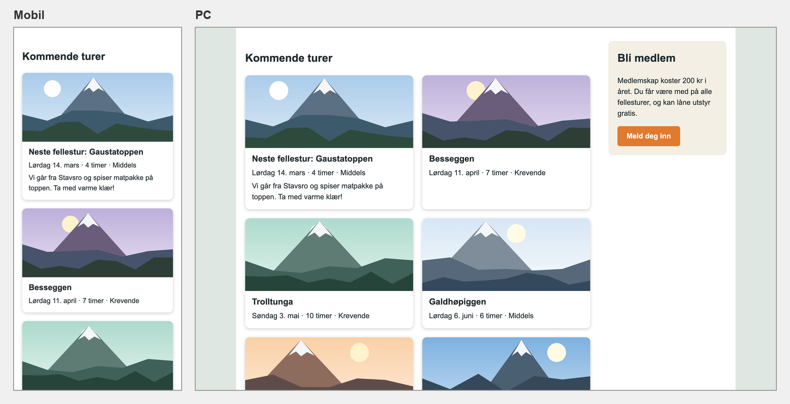

### Mobil først: `min-width`, ikke `max-width`

Du har kanskje sett media queries med `max-width` før. Begge virker, men tenk på hva de betyr:

| | Grunnreglene er for ... | Media queryen legger til ... |
|---|---|---|
| `@media (min-width: 800px)` | mobil | det som trengs på **større** skjermer |
| `@media (max-width: 800px)` | PC | det som må **fjernes eller overstyres** på mindre skjermer |

Med *mobil først* (`min-width`) bygger vi på det enkle, i stedet for å rive ned det kompliserte. Det blir som regel mindre kode.

> **Ny skrivemåte:** I nyere CSS kan du også skrive `@media (width >= 800px)`. Det betyr det samme som `min-width: 800px`, og er kanskje lettere å lese. Begge virker i alle moderne nettlesere.

### Hvor skal grensen gå?

Hvorfor akkurat 800 piksler? Det finnes ingen fasit, og du skal **ikke** velge tall ut fra hvor bred en iPhone er. Det kommer stadig nye skjermer. Gjør heller slik:

1. Gjør nettleservinduet smalt.
2. Dra det sakte bredere.
3. Der siden begynner å se dum ut, eller der det blir plass til noe nytt, setter du grensen.

Her trenger «Bli medlem» 300 piksler, og kortene trenger minst 250 piksler + luft. Rundt 800 piksler blir det plass til begge ved siden av hverandre.

---

# Del 3 – Bonus: container queries

## Steg 8: Et kort som tilpasser seg plassen det har fått

Det første kortet, «Neste fellestur», skal få litt ekstra oppmerksomhet. Vi lar det gå over hele bredden av kortlisten:

```css
.fremhevet {
    grid-column: 1 / -1;   /* fra første til siste kolonnelinje */
}
```

Når kortet er bredt, vil vi at bildet skal ligge **ved siden av** teksten, ikke over. Men *når* er kortet bredt? Det er ikke så enkelt som det høres ut:

- På en skjerm som er **700 px** bred, ligger alt i én kolonne. Kortet får nesten hele bredden og er **bredt**.
- På en skjerm som er **900 px** bred, har «Bli medlem» flyttet seg opp til høyre (steg 7). Kortet får mindre plass og er **smalt**.
- På en skjerm som er **1280 px** bred, er kortet **bredt** igjen.

En media query spør bare «hvor bred er *skjermen*?». Det er feil spørsmål her. Vi vil spørre «hvor bred er *boksen kortet ligger i*?». Det er det **container queries** gjør.

Først sier vi at `.kort-liste` er en *container*, altså en boks som andre kan spørre om bredden til:

```css
.kort-liste {
    container-type: inline-size;   /* «andre kan spørre hvor bred jeg er» */
}
```

Så skriver vi en `@container`, nesten akkurat som en `@media`:

```css
@container (min-width: 600px) {
    .fremhevet {
        display: grid;
        grid-template-columns: 1fr 1fr;   /* bilde til venstre, tekst til høyre */
        align-items: center;
    }

    .fremhevet img {
        height: 100%;
    }
}
```

Reglene inni gjelder når **kortlisten** er minst 600 piksler bred, uansett hvor bred skjermen er.

**Slik ser det ut nå:**

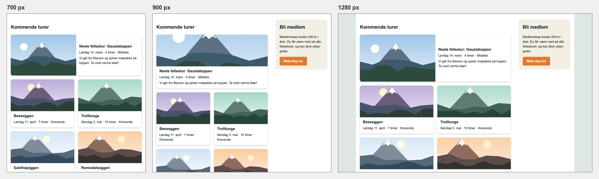

Se på bildet i midten: Skjermen er bredere enn i bildet til venstre, men kortet er smalere, fordi «Bli medlem» tar plass. Container queryen skjønner det. Det kunne ikke en media query ha gjort.

> **Hvorfor `.kort-liste`, og ikke `.kort`?** En boks kan ikke spørre om sin egen bredde. Det ville blitt en evig løkke: «Er jeg bred? Ja → bytt oppsett → nå er jeg kanskje smal → bytt tilbake → ...». Derfor er det alltid en **forelder** som er container.

> **Media query eller container query?**
> - **Media query:** for oppsettet av *hele siden* (hvor ligger header, main, aside ...).
> - **Container query:** for *én komponent* som kan havne på steder med ulik plass, som et kort som både står i en bred liste og i en smal sidekolonne.

---

## Steg 9: Test siden på ordentlig

### Mobilvisning i nettleseren

1. Høyreklikk på siden og velg **Inspiser** (eller trykk **F12**).
2. Klikk på mobil-ikonet 📱 øverst til venstre i utviklerverktøyene (eller **Cmd + Shift + M** / **Ctrl + Shift + M**).
3. Velg en telefon i menyen øverst, eller velg **Responsive** og dra i kanten for å endre bredden.

Dra sakte fra smal til bred, og følg med på: menyen (steg 3), antall kolonner (steg 4), overskriften (steg 5), «Bli medlem» (steg 7) og det fremhevede kortet (steg 8).

> **Test også det motsatte:** Kan siden scrolles **sidelengs** på mobil? Da er det noe som er for bredt. Bruk «Inspiser» og let etter elementet som stikker ut. Ofte er det et bilde uten `max-width: 100%`, eller noe med fast `width` i piksler.

### På din egen mobil

Mobilvisningen i nettleseren er god, men den er ikke en ekte mobil. Publiser siden med GitHub Pages ([se guide](../../github/guide%20-%20github%20og%20github%20desktop.md)) og åpne den på telefonen din.

### Hva skjer uten viewport-linjen?

Husker du viewport-linjen fra steg 1? Slik ser den ferdige siden ut på en mobil med og uten den:

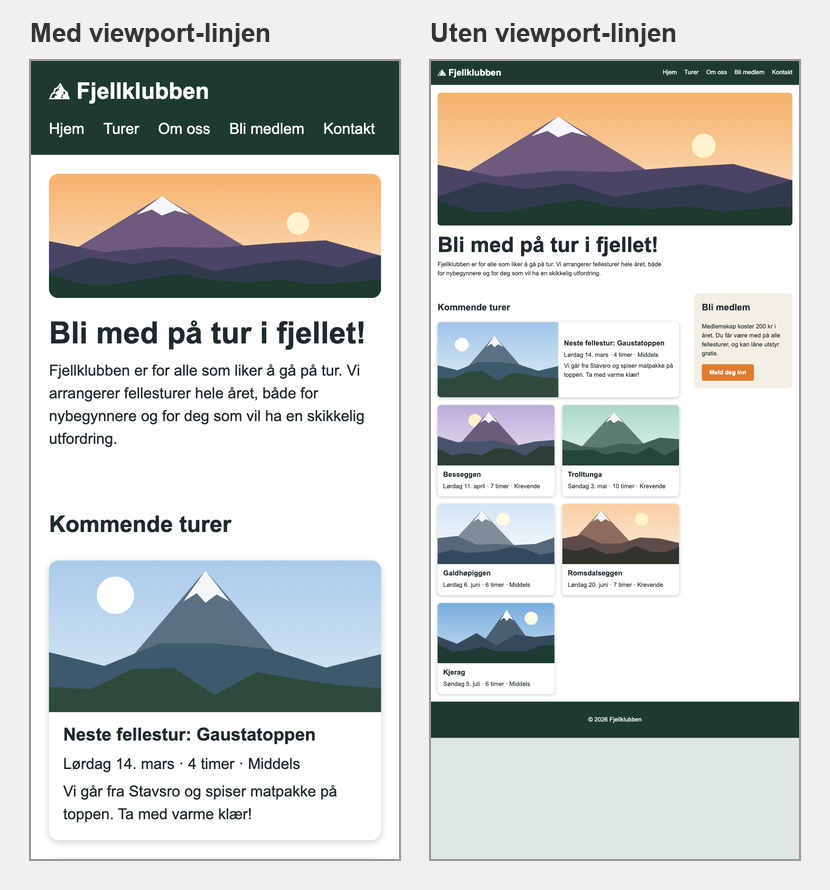

Uten linjen later mobilen som om skjermen er 980 piksler bred, og krymper hele siden for å få den til å passe. Media queryen tror den er på en PC, og alt blir bitte lite. Har du gjort alt riktig, men siden ser slik ut på mobilen? Sjekk viewport-linjen!

---

## Oppsummering

| Problem | Løsning | Media query? |
|---|---|---|
| Bilder stikker ut | `img { max-width: 100%; height: auto; }` | Nei |
| Menyen får ikke plass | `flex-wrap: wrap;` | Nei |
| For mange eller for få kolonner | `grid-template-columns: repeat(auto-fit, minmax(250px, 1fr));` | Nei |
| Overskriften er for stor på mobil | `font-size: clamp(2rem, 6vw, 3.5rem);` | Nei |
| Siden er for bred på store skjermer | `max-width: 1100px; margin: 0 auto;` | Nei |
| Oppsettet for hele siden skal endres | `@media (min-width: 800px) { ... }` | **Ja** |
| En komponent skal tilpasse seg plassen sin | `container-type` + `@container` | Nei, container query |

**Prøv å la ting tilpasse seg selv først. Bruk media query når oppsettet må endres.**

---

## Oppgaver

1. **Endre grensen.** Hva skjer hvis du endrer `minmax(250px, 1fr)` til `minmax(180px, 1fr)`? Og til `minmax(400px, 1fr)`?
2. **Bytt rekkefølge på mobil.** På mobilen ligger «Bli medlem» helt nederst, under alle kortene. Kanskje den burde komme rett under hero? Gjør `body` til et grid også på mobil (utenfor media queryen), med én kolonne og `grid-template-areas` i den rekkefølgen du vil.
3. **Hero ved siden av hverandre.** Lag en media query som legger bildet og teksten i `.hero` ved siden av hverandre når skjermen er minst 1000 piksler bred.
4. **Mer `clamp()`.** Bruk `clamp()` på `padding` i `.hero, main, aside, footer`, slik at det er lite luft på mobil og mer på PC.
5. **Din egen side.** Åpne en nettside du har laget tidligere, i mobilvisning. Hva er det første som går galt? Gå gjennom tabellen i oppsummeringen og fiks én ting om gangen.

---

## Ferdig kode

Hele koden ligger i [index.html](index.html) og [style.css](style.css).

**style.css**

```css
/* ---------- Grunnoppsett (steg 2) ---------- */

* {
    box-sizing: border-box;
}

html {
    background-color: #dfe7e2;
}

body {
    margin: 0 auto;
    max-width: 1100px;
    background-color: white;
    font-family: Arial, Helvetica, sans-serif;
    line-height: 1.5;
    color: #1f2a2e;
}

img {
    max-width: 100%;
    height: auto;
    display: block;
}

.hero,
main,
aside,
footer {
    padding: 20px;
}

/* ---------- Toppmeny (steg 3) ---------- */

header {
    display: flex;
    flex-wrap: wrap;
    justify-content: space-between;
    align-items: center;
    gap: 10px 30px;
    padding: 15px 20px;
    background-color: #1e3a2f;
}

header a {
    color: white;
    text-decoration: none;
}

.logo {
    font-size: 1.5rem;
    font-weight: bold;
}

nav {
    display: flex;
    flex-wrap: wrap;
    gap: 5px 20px;
}

nav a:hover {
    text-decoration: underline;
}

/* ---------- Toppbilde og overskrift (steg 2 og 5) ---------- */

.hero img {
    border-radius: 10px;
}

.hero h1 {
    font-size: clamp(2rem, 6vw, 3.5rem);
    line-height: 1.1;
    margin: 20px 0 10px;
}

.hero p {
    max-width: 600px;
    margin: 0;
}

/* ---------- Kortene (steg 4) ---------- */

.kort-liste {
    display: grid;
    grid-template-columns: repeat(auto-fit, minmax(250px, 1fr));
    gap: 20px;
}

.kort {
    background-color: white;
    border-radius: 10px;
    overflow: hidden;
    box-shadow: 0 2px 8px rgba(0, 0, 0, 0.2);
}

.kort img {
    width: 100%;
    height: 160px;
    object-fit: cover;
}

.kort-tekst {
    padding: 10px 15px;
}

.kort h3 {
    margin: 0 0 5px;
}

.kort p {
    margin: 0 0 5px;
}

/* ---------- Bli medlem og bunntekst (steg 2) ---------- */

aside {
    background-color: #f3efe4;
    border-radius: 10px;
    margin: 20px;
}

aside h2 {
    margin-top: 0;
}

.knapp {
    display: inline-block;
    padding: 10px 20px;
    border-radius: 5px;
    background-color: #e07a2e;
    color: white;
    font-weight: bold;
    text-decoration: none;
}

.knapp:hover {
    background-color: #c4621b;
}

footer {
    background-color: #1e3a2f;
    color: white;
    text-align: center;
}

/* ---------- Sideoppsett (steg 7) ---------- */

header { grid-area: header; }
.hero  { grid-area: hero; }
main   { grid-area: main; }
aside  { grid-area: aside; }
footer { grid-area: footer; }

@media (min-width: 800px) {
    body {
        display: grid;
        grid-template-columns: 1fr 300px;
        grid-template-areas:
            "header header"
            "hero   hero"
            "main   aside"
            "footer footer";
    }

    aside {
        align-self: start;
    }
}

/* ---------- Bonus: container queries (steg 8) ---------- */

.kort-liste {
    container-type: inline-size;
}

.fremhevet {
    grid-column: 1 / -1;
}

@container (min-width: 600px) {
    .fremhevet {
        display: grid;
        grid-template-columns: 1fr 1fr;
        align-items: center;
    }

    .fremhevet img {
        height: 100%;
    }
}
```
